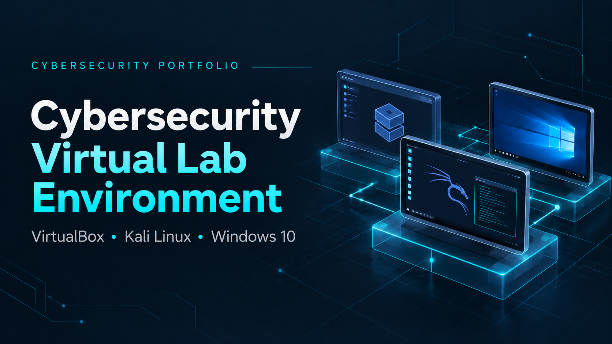
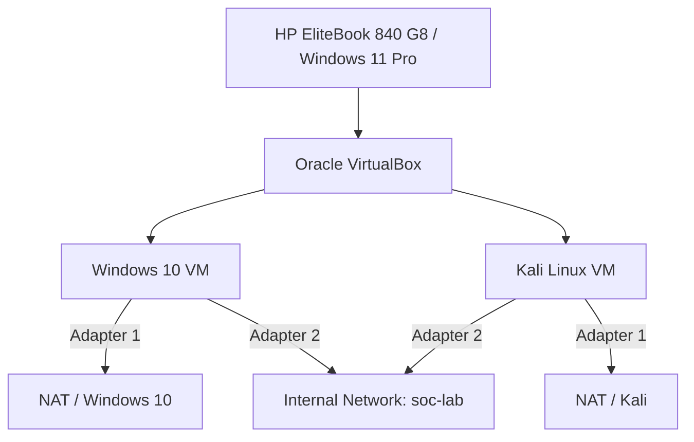

# Cybersecurity Virtual Lab Environment

**Project status:** In progress · **Started:** October 2026  
**Context:** Clark College Cybersecurity BAS coursework and related hands-on practice

**Portfolio overview:** [View the portfolio overview](PORTFOLIO-OVERVIEW.md).

**Project index:** [Published projects and open investigations](docs/project-index.md) — case studies and technical status.

## Overview

This virtual cybersecurity lab runs on a Windows 11 laptop using Oracle VirtualBox. The lab includes Windows 10 and Kali Linux virtual machines and supports operating-system configuration, network diagnostics and reproducible troubleshooting.

The workflow covers configuration, validation, network observation and documented troubleshooting while keeping guest changes separate from the primary Windows environment.

> **Scope:** The core of this repository documents the virtualized coursework lab. A separate personal-endpoint packet-analysis case study is linked below as related networking practice, not as VirtualBox guest testing or an assessment of campus infrastructure. The Ubuntu WSL 2 baseline assessment, home Pi-hole infrastructure and OctoPi retrospective are distinct projects.

## Environment

| Component | Configuration / role |
|---|---|
| Host | HP EliteBook 840 G8 running Windows 11 Pro |
| Hypervisor | Oracle VirtualBox |
| Guest VM | Windows 10 |
| Guest VM | Kali Linux |
| Lab networking | November 15, 2026 GUI inventory: both VMs have Adapter 1 NAT and Adapter 2 Internal Network `soc-lab`; Adapters 3–4 disabled. Kali addressing/routes observed; `eth1` matches Adapter 2 (`soc-lab`) by MAC; `eth0` does not match the earlier Adapter 1 screenshot and requires a current-config check; Windows 10 addressing and guest-to-guest connectivity pending |
| Related coursework tools | Wireshark, PowerShell, Linux terminal, Python (Visual Studio Code) |

The tools in the last row are used across related coursework; usage varies by exercise.

## High-level lab layout

The diagram captures the **configured** VirtualBox network attachments verified in the November 15 GUI inventory, not a tested guest-to-guest link. Each VM has NAT and an internal adapter attached to `soc-lab`. Neither VM currently has an enabled host-only adapter. NAT could provide outside connectivity; Kali guest addressing and routes are observed, but the NAT interface MAC discrepancy remains open; Windows 10 addressing and actual guest-to-guest reachability remain to be tested.

See the [network validation worksheet](docs/lab-network-validation.md) for the verified eight-adapter inventory, Kali address/route observations, and pending Windows 10 and connectivity checks.

## Work completed so far

### 1. Create and boot virtual machines

- Installed and configured Windows 10 and Kali Linux virtual machines in Oracle VirtualBox.
- Booted and shut down the Windows 10 VM successfully after troubleshooting the setup.
- Verified Kali Linux could boot after the Windows account and file-permission changes.
- Adjusted allocated resources when the virtual machines were running slowly.

### 2. Configure lab networking

- Earlier work included a VirtualBox host-only network, but neither of the current guest configurations uses host-only networking as of the November 15 GUI inventory.
- Verified both Windows 10 and Kali Linux have Adapter 1 **NAT**, Adapter 2 **Internal Network (`soc-lab`)**, and disabled Adapters 3–4.
- Collected Kali's current interface addresses, routes and link-layer addresses on November 15: `eth0` has `10.0.2.15/24` with default gateway `10.0.2.2`; `eth1` has `172.20.20.10/24`. `eth1`'s MAC matches the earlier Adapter 2 (`soc-lab`) screenshot; `eth0`'s MAC does not match the earlier Adapter 1 screenshot, so the current host-side VirtualBox MAC configuration needs verification. Windows 10 addressing remains pending.
- Studied network addressing and traffic inspection in associated networking assignments.

**Network validation pending:** The VM adapter configuration is documented and Kali's addresses/routes have been observed. NAT means the lab should **not** be described as entirely isolated. Windows 10 addressing, the Kali Adapter 1 MAC discrepancy, guest-to-guest reachability, and effective isolation have not been validated.

### 3. Troubleshoot permissions and access

- Worked with Windows account separation as part of the laptop's wider security configuration.
- Corrected access permissions for the Windows 10 VM files when moving between Windows accounts; the recorded file-permission operation reported 16 files processed without failures.
- Confirmed the Kali Linux VM launched under the standard Windows account.

These account and file-permission changes were made on the Windows host.

## Related technical work

Related Clark College coursework covers Wireshark traffic capture and filters, TCP/IP and OSI model interpretation, introductory Linux shell use and Python interpreter work. Planned lab documentation includes commands, configurations, outputs and explanations for each completed exercise.

## Related packet-analysis case study

[TCP/TLS Session Analysis — November 3, 2026](docs/tcp-tls-session-analysis-2026-11-03.md) — a controlled, personally generated HTTPS request captured on the Windows laptop's VPN interface, showing TCP connection establishment, TLS 1.3 negotiation and HTTP application-session headers. A separate Firefox service handshake demonstrated a hybrid post-quantum key exchange. This was **endpoint-level observation only**; it does not document or claim testing of campus infrastructure. Raw captures are not publicly shared.

## Evidence to add

Pending evidence is tracked in the [network validation worksheet](docs/lab-network-validation.md):

- [ ] VirtualBox overview showing the two guest machines
- [ ] Each VM successfully booted (with account details cropped)
- [x] Adapter configuration inspected for both VMs and documented in the worksheet (November 15)
- [ ] Sanitized VirtualBox NAT / internal adapter screenshots uploaded
- [ ] Guest IP configuration and a documented connectivity test
- [ ] A troubleshooting note with the symptom, change and verification result
- [x] A high-level diagram of the host and virtual machines

## Technical coverage

**Virtualization · Oracle VirtualBox · Windows 10 VM configuration · Kali Linux VM setup · NAT and internal networking · Basic network diagnostics · Technical troubleshooting · Documentation**

Project context: guided coursework and hands-on troubleshooting. Validation status is recorded alongside each result.

## Next improvements

1. Add sanitized screenshots of the verified network settings; MAC addresses must be redacted.
2. Verify current guest addressing, then perform a small reproducible internal-network connectivity test with expected and actual results.
3. Document one Wireshark capture from the lab, explaining the filter and protocol observations.
4. Keep a concise change log as the lab expands.

## Related portfolio projects

- [Linux Security Baseline Assessment — Ubuntu WSL 2](https://github.com/bemerson24/ubuntu-wsl2-security-baseline) — separate Linux diagnostics assessment.
- [Raspberry Pi Pi-hole](https://github.com/bemerson24/raspberry-pi-pihole) — DNS filtering, smart-TV query observations and [Windows 11 / WSL2 VPN DNS comparison](https://github.com/bemerson24/raspberry-pi-pihole/blob/main/case-studies/wsl2-bitdefender-pihole-dns-2026-11-15.md) (November 15, 2026; mechanism unresolved).
- [Raspberry Pi 400 — OctoPi 3D Printer Management](https://github.com/bemerson24/raspberry-pi-octopi) — retrospective documentation of a 2020–2024 printer-management setup.

## Security operations roadmap

The [Security Operations Project Roadmap](docs/security-operations-analyst-roadmap.md) tracks planned Windows event-log analysis, PowerShell collection, SIEM/KQL investigations and incident-response documentation. Each milestone specifies the evidence required for completion.

## Professional profile

[Brian Emerson on LinkedIn](https://www.linkedin.com/in/brianemersonpdx/) — professional background, education and career development.

## Change log

- **November 15, 2026 (network inventory):** Inspected all four VirtualBox adapter settings for both guests. Windows 10 and Kali each have Adapter 1 NAT and Adapter 2 Internal Network (`soc-lab`), with Adapters 3–4 disabled. Kali's `ip -br addr`, `ip route` and `ip -br link` outputs were collected: `eth0` `10.0.2.15/24`, default gateway `10.0.2.2`; `eth1` `172.20.20.10/24`. `eth1`'s MAC matches the earlier Adapter 2 (`soc-lab`) screenshot. `eth0`'s MAC does not match the earlier Adapter 1 screenshot; verify current host-side VirtualBox MAC settings before concluding. Windows 10 guest addressing, sanitized screenshots and guest-to-guest connectivity remain pending.

- **November 12, 2026:** Switched from Thonny to Visual Studio Code (VS Code) for Python coursework. Investigated intermittent Windows 10 guest unresponsiveness. On the Windows host, `VBoxManage showvminfo "Windows 10" --machinereadable` first reported `VMState="paused"`. After resuming, the symptom returned while VirtualBox reported `VMState="running"`. The guest responded after Ctrl+Alt+Del. The cause of the recurrence remains open.

- **November 3, 2026 (packet analysis):** Added a separate Wireshark case study covering verified TCP/TLS handshakes, per-connection key-exchange comparison, browser troubleshooting and limitations of campus Wi-Fi observations.

- **October 2026:** Created and configured the initial Windows 10 and Kali Linux virtualized lab, established host-only networking and worked through initial boot, resource and file-access troubleshooting.
- **October 18, 2026 (documentation):** Added a high-level diagram and a validation worksheet; guest adapter inventory and connectivity evidence remain pending.

