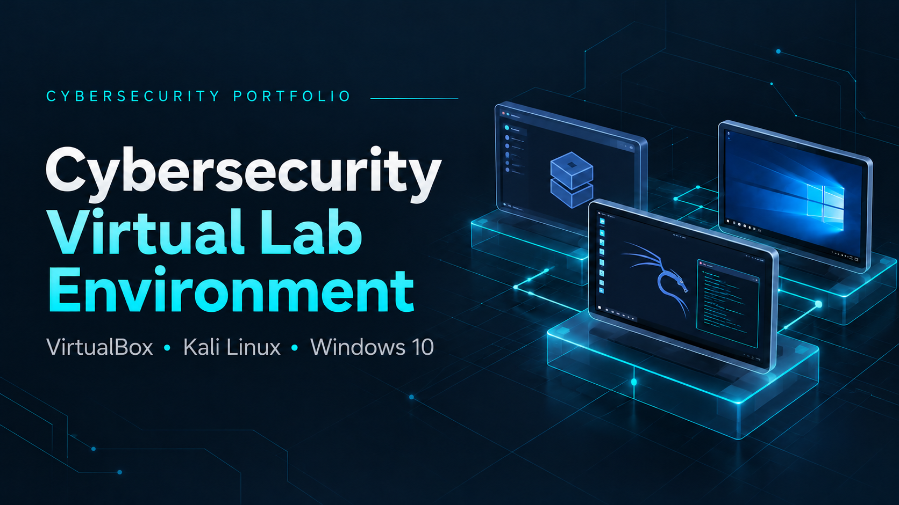
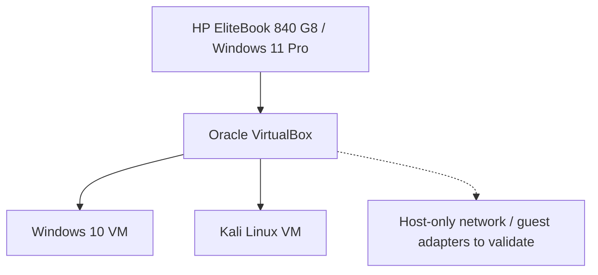

# Cybersecurity Virtual Lab Environment

**Project status:** In progress · **Started:** October 2026  
**Context:** Clark College Cybersecurity BAS coursework and related hands-on practice

**Portfolio overview:** [View the portfolio overview](PORTFOLIO-OVERVIEW.md).

**Project index:** [Published work, open investigations and project backlog](docs/project-index.md) — case studies, open questions and planned lab work.

## Overview

This virtual cybersecurity lab runs on a Windows 11 laptop using Oracle VirtualBox. The lab includes Windows 10 and Kali Linux virtual machines and supports operating-system configuration, network diagnostics and reproducible troubleshooting.

The workflow covers configuration, validation, network observation and documented troubleshooting while keeping guest changes separate from the primary Windows environment.

> **Scope:** The core of this repository documents the virtualized coursework lab. A separate personal-endpoint packet-analysis case study is linked below as related networking practice, not as VirtualBox guest testing or an assessment of campus infrastructure. The Ubuntu WSL 2 baseline assessment, home Pi-hole infrastructure, OctoPi retrospective and planned portable Raspberry Pi capstone are distinct projects.

## Environment

| Component | Configuration / role |
|---|---|
| Host | HP EliteBook 840 G8 running Windows 11 Pro |
| Hypervisor | Oracle VirtualBox |
| Guest VM | Windows 10 |
| Guest VM | Kali Linux |
| Lab networking | Host-only network created; per-guest adapter inventory and connectivity validation pending |
| Related coursework tools | Wireshark, PowerShell, Linux terminal, Python/Thonny |

The tools in the last row are used across related coursework; usage varies by exercise.

## High-level lab layout

The diagram captures the **documented host and two guests**. A host-only network has been created for the lab, but the per-VM enabled-adapter inventory has not yet been published. The dotted line shows a configuration item to verify, **not** proof that every VM has only host-only connectivity.

See the [network validation worksheet](docs/lab-network-validation.md) for the pending adapter inventory, guest addressing checks and connectivity-test evidence.

## Work completed so far

### 1. Create and boot virtual machines

- Installed and configured Windows 10 and Kali Linux virtual machines in Oracle VirtualBox.
- Booted and shut down the Windows 10 VM successfully after troubleshooting the setup.
- Verified Kali Linux could boot after the Windows account and file-permission changes.
- Adjusted allocated resources when the virtual machines were running slowly.

### 2. Configure lab networking

- Set up a VirtualBox host-only network for lab isolation.
- Examined guest IP configuration and submitted screenshots as coursework evidence.
- Studied network addressing and traffic inspection in associated networking assignments.

**Network validation pending:** The enabled-adapter inventory and connectivity tests remain to be documented for each guest. Additional NAT or bridged adapters would change the isolation boundary.

### 3. Troubleshoot permissions and access

- Worked with Windows account separation as part of the laptop's wider security configuration.
- Corrected access permissions for the Windows 10 VM files when moving between Windows accounts; the recorded file-permission operation reported 16 files processed without failures.
- Confirmed the Kali Linux VM launched under the standard Windows account.

These account and file-permission changes were made on the Windows host.

## Related technical work

Related Clark College coursework covers Wireshark traffic capture and filters, TCP/IP and OSI model interpretation, introductory Linux shell use and Python interpreter work. Planned lab documentation includes commands, configurations, outputs and explanations for each completed exercise.

## Related packet-analysis case study

[TCP/TLS Session Analysis — November 3, 2026](docs/tcp-tls-session-analysis-2026-11-03.md) — a controlled, personally generated HTTPS request captured on the Windows laptop's VPN interface, showing TCP connection establishment, TLS 1.3 negotiation and HTTP application-session headers. A separate Firefox service handshake demonstrated a hybrid post-quantum key exchange. This was **endpoint-level observation only**; it does not document or claim testing of campus infrastructure. Raw captures are not publicly shared.

## Evidence to add

Published evidence must exclude credentials and private identifiers. Coursework materials require permission for republication.

Planned evidence (use the [network validation worksheet](docs/lab-network-validation.md) to capture actual results before claiming verification):

- [ ] VirtualBox overview showing the two guest machines
- [ ] Each VM successfully booted (with account details cropped)
- [ ] VirtualBox host-only adapter configuration
- [ ] Guest IP configuration and a documented connectivity test
- [ ] A troubleshooting note with the symptom, change and verification result
- [x] A high-level diagram of the host and virtual machines

## Technical coverage

**Virtualization · Oracle VirtualBox · Windows 10 VM configuration · Kali Linux VM setup · Host-only networking · Basic network diagnostics · Technical troubleshooting · Documentation**

Project context: guided coursework and hands-on troubleshooting. Validation status is recorded alongside each result.

## Next improvements

1. Record a sanitized virtual network diagram and adapter settings.
2. Add a small reproducible connectivity test with expected and actual results.
3. Document one Wireshark capture from the lab, explaining the filter and protocol observations.
4. Keep a concise change log as the lab expands.

## Related portfolio projects

- [Linux Security Baseline Assessment — Ubuntu WSL 2](https://github.com/bemerson24/ubuntu-wsl2-security-baseline) — separate Linux diagnostics assessment.
- [Raspberry Pi Pi-hole](https://github.com/bemerson24/raspberry-pi-pihole) — DNS filtering and a preliminary, documented smart-TV DNS investigation.
- [Raspberry Pi 400 — OctoPi 3D Printer Management](https://github.com/bemerson24/raspberry-pi-octopi) — retrospective documentation of a 2020–2024 printer-management setup.

## Planned portfolio work

The following are separate project concepts and **are not yet represented as completed projects**:

- **Portable Raspberry Pi cybersecurity lab:** planning and hardware inventory for a physical, segmented lab; implementation and validation are still pending.
- **Console revival and physical-media inventory:** planned documentation of the existing modded Wii, PS4 setup/revival, original fat PS3 revival, accessories, game inventory and troubleshooting. This will remain separate from the cybersecurity coursework lab.

## Security operations roadmap

The [Security Operations Project Roadmap](docs/security-operations-analyst-roadmap.md) tracks planned Windows event-log analysis, PowerShell collection, SIEM/KQL investigations and incident-response documentation. Each milestone specifies the evidence required for completion.

## Professional profile

[Brian Emerson on LinkedIn](https://www.linkedin.com/in/brianemersonpdx/) — professional background, education and career development.

## Change log

- **November 3, 2026 (packet analysis):** Added a separate Wireshark case study covering verified TCP/TLS handshakes, per-connection key-exchange comparison, browser troubleshooting and limitations of campus Wi-Fi observations.

- **October 2026:** Created and configured the initial Windows 10 and Kali Linux virtualized lab, established host-only networking and worked through initial boot, resource and file-access troubleshooting.
- **October 18, 2026 (documentation):** Added a high-level diagram and a validation worksheet; guest adapter inventory and connectivity evidence remain pending.
- **October 26, 2026 (portfolio navigation):** Added cross-links to related existing projects and identified separate planned projects without presenting planned work as completed.
- **October 26, 2026 (profile navigation):** Added a LinkedIn profile link.

