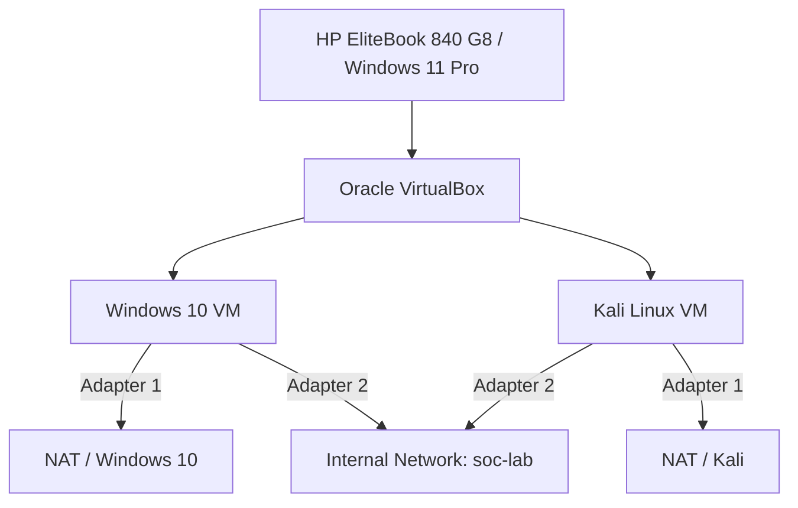

# Cybersecurity Virtual Lab Environment

**Project status:** In progress · **Started:** October 2026  
**Context:** Clark College Cybersecurity BAS coursework and related hands-on practice

**Portfolio overview:** [View the portfolio overview](PORTFOLIO-OVERVIEW.md).

**Project index:** [Published projects and open investigations](docs/project-index.md) — case studies and technical status.

**Current priority:** Validate the evidence, privacy and technical claims in existing projects before adding new work. The next major milestone is a controlled security-event investigation.

## Overview

I built this virtual cybersecurity lab on a Windows 11 laptop using Oracle VirtualBox. It contains Windows 10 and Kali Linux guests that I use to practice operating-system configuration, networking, and reproducible troubleshooting. Guest stability is currently under investigation.

I document configuration changes, validation results, network observations, and troubleshooting while keeping guest changes separate from the primary Windows environment.

> **Scope:** The core of this repository documents the virtualized coursework lab. A separate personal-endpoint packet-analysis case study is linked below as related networking practice, not as VirtualBox guest testing or an assessment of campus infrastructure. The Ubuntu WSL 2 baseline assessment, home Pi-hole infrastructure and OctoPi retrospective are distinct projects.

## Environment

| Component | Configuration / role |
|---|---|
| Host | HP EliteBook 840 G8 running Windows 11 Pro |
| Hypervisor | Oracle VirtualBox |
| Guest VM | Windows 10 |
| Guest VM | Kali Linux |
| Lab networking | Both guests: Adapter 1 NAT, Adapter 2 Internal Network (`soc-lab`). Kali `172.20.20.10/24`; Windows 10 `172.20.20.20/24`. Interface assignment and host/guest routes verified; **guest-to-guest connectivity not yet tested**. See the [validation worksheet](docs/lab-network-validation.md) |
| Related coursework tools | Wireshark, PowerShell, Linux terminal, Python (Visual Studio Code) |

The tools in the last row are used across related coursework; usage varies by exercise.

## High-level lab layout

The diagram shows the **verified adapter configuration**, not a validated guest-to-guest connection. Both guests have NAT and an internal interface on `soc-lab`; neither currently uses a host-only adapter. The [worksheet](docs/lab-network-validation.md) contains the MAC/interface checks, addresses, routes, and outstanding connectivity tests.

See the [network validation worksheet](docs/lab-network-validation.md) for the verified eight-adapter inventory, confirmed guest addressing/routes, and still-pending guest-to-guest connectivity tests.

## Work completed so far

### 1. Create and boot virtual machines

- Installed and configured Windows 10 and Kali Linux virtual machines in Oracle VirtualBox.
- Booted and shut down the Windows 10 VM successfully after troubleshooting the setup.
- Verified Kali Linux could boot after the Windows account and file-permission changes.
- Adjusted allocated resources when the virtual machines were running slowly.

### 2. Configure lab networking

- Earlier work included a VirtualBox host-only network, but neither of the current guest configurations uses host-only networking as of the November 15 GUI inventory.
- Verified both Windows 10 and Kali Linux have Adapter 1 **NAT**, Adapter 2 **Internal Network (`soc-lab`)**, and disabled Adapters 3–4.
- Verified the adapter-to-interface mappings and routes. Kali's `eth1` is `172.20.20.10/24`; Windows 10's `Ethernet 2` changed from APIPA to `172.20.20.20/24`. I verified the new on-link route and preserved NAT default route. [Full command-level evidence](docs/lab-network-validation.md).
- Studied network addressing and traffic inspection in associated networking assignments.

**Pending:** I have not yet demonstrated guest-to-guest reachability or effective isolation. NAT attachments mean the overall lab is not entirely isolated. Testing is deferred while the VM stability issue remains open.

### 3. Troubleshoot permissions and access

- Worked with Windows account separation as part of the laptop's wider security configuration.
- Corrected access permissions for the Windows 10 VM files when moving between Windows accounts; the recorded file-permission operation reported 16 files processed without failures.
- Confirmed the Kali Linux VM launched under the standard Windows account.

These account and file-permission changes were made on the Windows host.

## Related technical work

Related Clark College coursework covers Wireshark traffic capture and filters, TCP/IP and OSI model interpretation, introductory Linux shell use and Python interpreter work. Planned lab documentation includes commands, configurations, outputs and explanations for each completed exercise.

## Related packet-analysis case study

[TCP/TLS Session Analysis — November 3, 2026](docs/tcp-tls-session-analysis-2026-11-03.md) — a controlled, personally generated HTTPS request captured on the Windows laptop's VPN interface, showing TCP connection establishment, TLS 1.3 negotiation and HTTP application-session headers. A separate Firefox service handshake demonstrated a hybrid post-quantum key exchange. This was **endpoint-level observation only**; it does not document or claim testing of campus infrastructure. Raw captures are not publicly shared.

## Evidence to add

Pending evidence is tracked in the [network validation worksheet](docs/lab-network-validation.md):

- [ ] VirtualBox overview showing the two guest machines
- [ ] Each VM successfully booted (with account details cropped)
- [x] Adapter configuration inspected for both VMs and documented in the worksheet (November 15)
- [ ] Sanitized VirtualBox NAT / internal adapter screenshots uploaded
- [x] Guest IP configuration inspected for both VMs; Windows 10 initially had APIPA on its internal adapter
- [x] Windows 10 internal adapter configured as `172.20.20.20/24` and confirmed with `ipconfig`
- [x] Verify Windows 10 updated internal-subnet route and unchanged NAT default route
- [ ] Document guest-to-guest connectivity test
- [x] A troubleshooting note with the symptom, change and verification result
- [x] A high-level diagram of the host and virtual machines

## Technical coverage

**Virtualization · Oracle VirtualBox · Windows 10 VM configuration · Kali Linux VM setup · NAT and internal networking · Basic network diagnostics · Technical troubleshooting · Documentation**

Project context: guided coursework and hands-on troubleshooting. Validation status is recorded alongside each result.

## Next improvements

I am prioritizing evidence quality, privacy review and existing troubleshooting questions before expanding this lab. Outstanding network screenshots and guest-to-guest testing remain deferred pending privacy review and VM stability. I will not label untested connectivity or future packet analysis as completed.

## Related portfolio projects

- [Linux Security Baseline Assessment — Ubuntu WSL 2](https://github.com/bemerson24/ubuntu-wsl2-security-baseline) — separate Linux diagnostics assessment.
- [Raspberry Pi Pi-hole](https://github.com/bemerson24/raspberry-pi-pihole) — DNS filtering, smart-TV query observations and [Windows 11 / WSL2 VPN DNS comparison](https://github.com/bemerson24/raspberry-pi-pihole/blob/main/case-studies/wsl2-bitdefender-pihole-dns-2026-11-15.md) (November 15, 2026; mechanism unresolved).
- [Raspberry Pi 400 — OctoPi 3D Printer Management](https://github.com/bemerson24/raspberry-pi-octopi) — retrospective documentation of a 2020–2024 printer-management setup.

## Security operations roadmap

The [Security Operations Project Roadmap](docs/security-operations-analyst-roadmap.md) tracks planned Windows event-log analysis, PowerShell collection, SIEM/KQL investigations and incident-response documentation. Each milestone specifies the evidence required for completion.

## Professional profile

[Brian Emerson on LinkedIn](https://www.linkedin.com/in/brianemersonpdx/) — professional background, education and career development.

## VirtualBox performance investigation

**Current status (November 15, 2026):** The Windows 10 guest has repeatedly become severely sluggish or unresponsive, including when Kali is powered off and after reducing Windows 10 from four to two vCPUs. On the Windows 11 Pro 26H2 host (build `26300.9974`), VirtualBox `7.2.22r175245` reports NEM fallback and snail execution mode. One affected VM session logged a **244.381-second virtual time-manager catch-up lag**. The specific defect is not established, and I have not changed WSL2, VBS, Memory Integrity or BitLocker as a performance workaround.

- [Read the technical investigation and supporting evidence](docs/lab-network-validation.md)
- [Read my approved VirtualBox NEM/WHPX compatibility report](docs/virtualbox-nem-whpx-issue-report-2026-11-15.md) — published as [my November 16 contribution to VirtualBox issue #972](https://github.com/VirtualBox/virtualbox/issues/972#issuecomment-6924524139); root cause remains unresolved
- [Read the complete dated troubleshooting history](docs/virtualbox-investigation-history.md) — earlier checks and intermediate hypotheses are retained without cluttering this README
