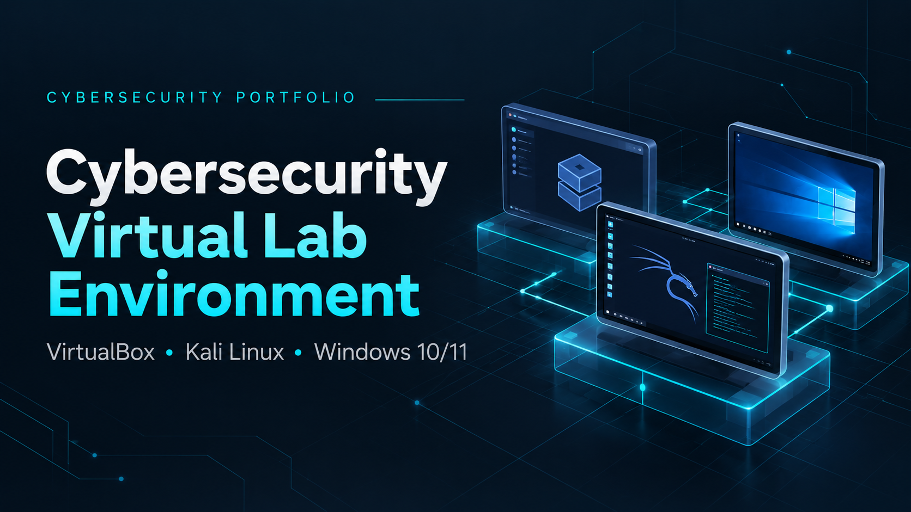
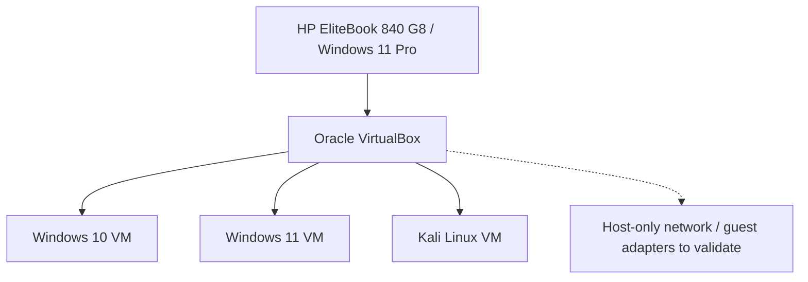

# Cybersecurity Virtual Lab Environment

**Project status:** In progress · **Started:** October 2026  
**Context:** Clark College Cybersecurity BAS coursework and related hands-on practice

## Overview

I am building and maintaining a virtual cybersecurity lab on a Windows 11 laptop using Oracle VirtualBox. The lab includes Windows 10, Windows 11, and Kali Linux virtual machines and supports controlled practice with operating systems, networking, troubleshooting, and cybersecurity fundamentals.

The goal is to develop repeatable technical skills: configure a system, validate that it works, inspect network behavior, document the outcome, and troubleshoot problems without disrupting the primary Windows environment.

> **Scope:** This repository documents the virtualized coursework lab only. My separate Ubuntu WSL 2 baseline assessment, Windows host security configuration, permanent home Pi-hole infrastructure, and planned portable Raspberry Pi capstone are distinct projects.

## Environment

| Component | Configuration / role |
|---|---|
| Host | HP EliteBook 840 G8 running Windows 11 Pro |
| Hypervisor | Oracle VirtualBox |
| Guest VM | Windows 10 |
| Guest VM | Windows 11 |
| Guest VM | Kali Linux |
| Lab networking | VirtualBox host-only networking used for isolated lab connectivity |
| Related coursework tools | Wireshark, PowerShell, Linux terminal, Python/Thonny |

The tools in the last row are part of broader coursework. Their inclusion here does **not** imply every tool has been used inside each virtual machine.

## High-level lab layout

The diagram captures the **documented host and three guests**. A host-only network has been created for the lab, but the per-VM enabled-adapter inventory has not yet been published. The dotted line shows a configuration item to verify, **not** proof that every VM has only host-only connectivity.

See the [network validation worksheet](docs/lab-network-validation.md) for the pending adapter inventory, guest addressing checks, and connectivity-test evidence.

## Work completed so far

### 1. Create and boot virtual machines

- Installed and configured Windows 10, Windows 11, and Kali Linux virtual machines in Oracle VirtualBox.
- Booted and shut down the Windows 10 VM successfully after troubleshooting the setup.
- Verified Kali Linux could boot after the Windows account and file-permission changes.
- Adjusted allocated resources when the virtual machines were running slowly.

### 2. Configure lab networking

- Set up a VirtualBox host-only network for lab isolation.
- Examined guest IP configuration and submitted screenshots as coursework evidence.
- Studied network addressing and traffic inspection in associated networking assignments.

**Boundary:** Host-only networking reduces direct external connectivity, but actual guest adapter settings and any additional NAT/bridged adapters should be rechecked before running potentially risky exercises. This README does not claim the complete environment has been penetration-tested or formally audited.

### 3. Troubleshoot permissions and access

- Worked with Windows account separation as part of the laptop's wider security configuration.
- Corrected access permissions for the Windows 10 VM files when moving between Windows accounts; the recorded file-permission operation reported 16 files processed without failures.
- Confirmed the Kali Linux VM launched under the standard Windows account.

Host endpoint-hardening details belong in a separate project rather than being presented here as virtual lab accomplishments.

## Related learning activities

My Clark College coursework has included Wireshark traffic capture and filters, TCP/IP and OSI model interpretation, introductory Linux shell use, and Python interpreter work. As I complete repeatable exercises specifically in this virtual environment, I will add commands, configurations, outputs, and short explanations here.

## Evidence to add

Screenshots and lab notes should be uploaded only after checking for private information, account identifiers, passwords, IP addresses that should remain private, personal filenames, and any coursework materials that are not mine to republish.

Planned evidence (use the [network validation worksheet](docs/lab-network-validation.md) to capture actual results before claiming verification):

- [ ] VirtualBox overview showing the three guest machines
- [ ] Each VM successfully booted (with account details cropped)
- [ ] VirtualBox host-only adapter configuration
- [ ] Guest IP configuration and a documented connectivity test
- [ ] A troubleshooting note with the symptom, change, and verification result
- [ ] A simple topology diagram showing only the virtual lab

## Skills demonstrated so far

**Virtualization · Oracle VirtualBox · Windows 10/11 VM configuration · Kali Linux VM setup · Host-only networking · Basic network diagnostics · Technical troubleshooting · Documentation**

These are **foundational, guided hands-on skills** developed during coursework. Future entries will distinguish lab observations from independently verified results.

## Next improvements

1. Record a sanitized virtual network diagram and adapter settings.
2. Add a small reproducible connectivity test with expected and actual results.
3. Document one Wireshark capture from the lab, explaining the filter and protocol observations.
4. Keep a concise change log as the lab expands.

## Related portfolio project

- [Linux Security Baseline Assessment — Ubuntu WSL 2](https://github.com/bemerson24/ubuntu-wsl2-security-baseline): separate, self-directed Linux diagnostics project.

## Change log

- **October 2026:** Created and configured the initial Windows 10, Windows 11, and Kali Linux virtualized lab, established host-only networking, and worked through initial boot, resource, and file-access troubleshooting.
- **October 18, 2026 (documentation):** Added a high-level diagram and a validation worksheet; guest adapter inventory and connectivity evidence remain pending.

---

*This is a learning portfolio project, not a production security assessment. No offensive testing against unauthorized systems is documented or endorsed.*
