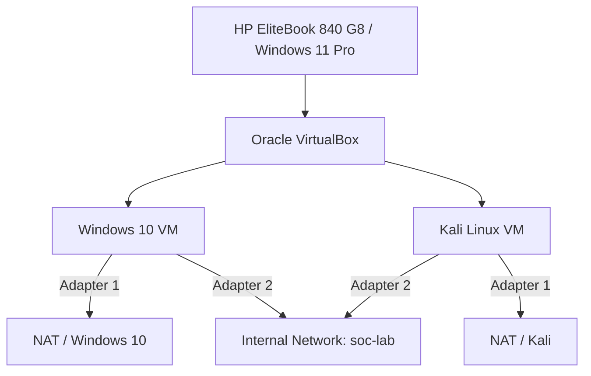

# Cybersecurity Virtual Lab Environment

**Project status:** In progress · **Started:** October 2026  
**Context:** Clark College Cybersecurity BAS coursework and related hands-on practice

**Portfolio overview:** [View the portfolio overview](PORTFOLIO-OVERVIEW.md).

**Project index:** [Published projects and open investigations](docs/project-index.md) — case studies and technical status.

## Overview

This virtual cybersecurity lab runs on a Windows 11 laptop using Oracle VirtualBox. The lab includes Windows 10 and Kali Linux virtual machines and supports operating-system configuration, network diagnostics and reproducible troubleshooting.

The workflow covers configuration, validation, network observation and documented troubleshooting while keeping guest changes separate from the primary Windows environment.

> **Scope:** The core of this repository documents the virtualized coursework lab. A separate personal-endpoint packet-analysis case study is linked below as related networking practice, not as VirtualBox guest testing or an assessment of campus infrastructure. The Ubuntu WSL 2 baseline assessment, home Pi-hole infrastructure and OctoPi retrospective are distinct projects.

## Environment

| Component | Configuration / role |
|---|---|
| Host | HP EliteBook 840 G8 running Windows 11 Pro |
| Hypervisor | Oracle VirtualBox |
| Guest VM | Windows 10 |
| Guest VM | Kali Linux |
| Lab networking | November 15, 2026 GUI inventory: both VMs have Adapter 1 NAT and Adapter 2 Internal Network `soc-lab`; Adapters 3–4 disabled. Kali addressing/routes and both MAC-to-adapter mappings verified (`eth0` = Adapter 1/NAT; `eth1` = Adapter 2/`soc-lab`); Windows 10 internal `Ethernet 2` assigned `172.20.20.20/24` (previously APIPA); post-change internal on-link route and NAT default route verified; guest-to-guest connectivity pending |
| Related coursework tools | Wireshark, PowerShell, Linux terminal, Python (Visual Studio Code) |

The tools in the last row are used across related coursework; usage varies by exercise.

## High-level lab layout

The diagram captures the **configured** VirtualBox network attachments verified in the November 15 GUI inventory, not a tested guest-to-guest link. Each VM has NAT and an internal adapter attached to `soc-lab`. Neither VM currently has an enabled host-only adapter. NAT could provide outside connectivity; Kali guest addressing, routes and interface-to-adapter MAC mapping are verified; Windows 10's internal adapter has been configured as `172.20.20.20/24` and confirmed with `ipconfig`; post-change routing is verified; actual guest-to-guest reachability remains to be tested.

See the [network validation worksheet](docs/lab-network-validation.md) for the verified eight-adapter inventory, Kali address/route observations, and pending Windows 10 and connectivity checks.

## Work completed so far

### 1. Create and boot virtual machines

- Installed and configured Windows 10 and Kali Linux virtual machines in Oracle VirtualBox.
- Booted and shut down the Windows 10 VM successfully after troubleshooting the setup.
- Verified Kali Linux could boot after the Windows account and file-permission changes.
- Adjusted allocated resources when the virtual machines were running slowly.

### 2. Configure lab networking

- Earlier work included a VirtualBox host-only network, but neither of the current guest configurations uses host-only networking as of the November 15 GUI inventory.
- Verified both Windows 10 and Kali Linux have Adapter 1 **NAT**, Adapter 2 **Internal Network (`soc-lab`)**, and disabled Adapters 3–4.
- Collected Kali's current interface addresses, routes and link-layer addresses on November 15: `eth0` has `10.0.2.15/24` with default gateway `10.0.2.2`; `eth1` has `172.20.20.10/24`. Compared Kali's interface MACs with current host-side `VBoxManage showvminfo` output: `eth0` matches Adapter 1 (NAT), and `eth1` matches Adapter 2 (`soc-lab`). Windows 10's NAT and internal adapter addresses/routes were collected; the internal `Ethernet 2` adapter initially had APIPA, then was configured as `172.20.20.20/24` with no IPv4 gateway or DNS. Post-change `ipconfig` confirmed the address, and `route print -4` verified the on-link `172.20.20.0/24` route and unchanged NAT default route; guest connectivity has not yet been tested.
- Studied network addressing and traffic inspection in associated networking assignments.

**Network validation pending:** The VM adapter configuration is documented and Kali's addresses/routes have been observed. NAT means the lab should **not** be described as entirely isolated. Windows 10's internal adapter now has `172.20.20.20/24`. Its updated route table has been verified; guest-to-guest reachability and effective isolation have not been validated.

### 3. Troubleshoot permissions and access

- Worked with Windows account separation as part of the laptop's wider security configuration.
- Corrected access permissions for the Windows 10 VM files when moving between Windows accounts; the recorded file-permission operation reported 16 files processed without failures.
- Confirmed the Kali Linux VM launched under the standard Windows account.

These account and file-permission changes were made on the Windows host.

## Related technical work

Related Clark College coursework covers Wireshark traffic capture and filters, TCP/IP and OSI model interpretation, introductory Linux shell use and Python interpreter work. Planned lab documentation includes commands, configurations, outputs and explanations for each completed exercise.

## Related packet-analysis case study

[TCP/TLS Session Analysis — November 3, 2026](docs/tcp-tls-session-analysis-2026-11-03.md) — a controlled, personally generated HTTPS request captured on the Windows laptop's VPN interface, showing TCP connection establishment, TLS 1.3 negotiation and HTTP application-session headers. A separate Firefox service handshake demonstrated a hybrid post-quantum key exchange. This was **endpoint-level observation only**; it does not document or claim testing of campus infrastructure. Raw captures are not publicly shared.

## Evidence to add

Pending evidence is tracked in the [network validation worksheet](docs/lab-network-validation.md):

- [ ] VirtualBox overview showing the two guest machines
- [ ] Each VM successfully booted (with account details cropped)
- [x] Adapter configuration inspected for both VMs and documented in the worksheet (November 15)
- [ ] Sanitized VirtualBox NAT / internal adapter screenshots uploaded
- [x] Guest IP configuration inspected for both VMs; Windows 10 initially had APIPA on its internal adapter
- [x] Windows 10 internal adapter configured as `172.20.20.20/24` and confirmed with `ipconfig`
- [x] Verify Windows 10 updated internal-subnet route and unchanged NAT default route
- [ ] Document guest-to-guest connectivity test
- [ ] A troubleshooting note with the symptom, change and verification result
- [x] A high-level diagram of the host and virtual machines

## Technical coverage

**Virtualization · Oracle VirtualBox · Windows 10 VM configuration · Kali Linux VM setup · NAT and internal networking · Basic network diagnostics · Technical troubleshooting · Documentation**

Project context: guided coursework and hands-on troubleshooting. Validation status is recorded alongside each result.

## Next improvements

1. Add sanitized screenshots of the verified network settings; MAC addresses must be redacted.
2. Verify current guest addressing, then perform a small reproducible internal-network connectivity test with expected and actual results.
3. Document one Wireshark capture from the lab, explaining the filter and protocol observations.
4. Keep a concise change log as the lab expands.

## Related portfolio projects

- [Linux Security Baseline Assessment — Ubuntu WSL 2](https://github.com/bemerson24/ubuntu-wsl2-security-baseline) — separate Linux diagnostics assessment.
- [Raspberry Pi Pi-hole](https://github.com/bemerson24/raspberry-pi-pihole) — DNS filtering, smart-TV query observations and [Windows 11 / WSL2 VPN DNS comparison](https://github.com/bemerson24/raspberry-pi-pihole/blob/main/case-studies/wsl2-bitdefender-pihole-dns-2026-11-15.md) (November 15, 2026; mechanism unresolved).
- [Raspberry Pi 400 — OctoPi 3D Printer Management](https://github.com/bemerson24/raspberry-pi-octopi) — retrospective documentation of a 2020–2024 printer-management setup.

## Security operations roadmap

The [Security Operations Project Roadmap](docs/security-operations-analyst-roadmap.md) tracks planned Windows event-log analysis, PowerShell collection, SIEM/KQL investigations and incident-response documentation. Each milestone specifies the evidence required for completion.

## Professional profile

[Brian Emerson on LinkedIn](https://www.linkedin.com/in/brianemersonpdx/) — professional background, education and career development.

- **November 15, 2026 (Windows hypervisor evidence):** The host `Win32_DeviceGuard` query returned `VirtualizationBasedSecurityStatus=2` (VBS running) and `SecurityServicesRunning={2,3,4}` (Memory Integrity/HVCI, System Guard Secure Launch, SMM Firmware Measurement). These observations are consistent with VirtualBox's continued NEM fallback under a Windows hypervisor. They do not independently establish which protection or subsystem causes the severe slowdown. No host protections or boot features were changed. See [network validation worksheet](docs/lab-network-validation.md).

- **November 15, 2026 (host optional-feature inventory):** A non-elevated, read-only `Win32_OptionalFeature` query returned `VirtualMachinePlatform=1` (enabled), `HypervisorPlatform=2` (disabled), and `Microsoft-Hyper-V-All=2` (disabled). Combined with VBS status `2` (running) and VirtualBox NEM fallback logs, this clarifies that the optional full Hyper-V feature can be disabled while a Windows hypervisor remains active. Oracle VirtualBox 7.2 documents Windows Hypervisor Platform as a requirement for its Hyper-V compatibility path; its disabled state remains an unproven diagnostic lead, not a validated remedy. A subsequent VM log showed `WinHvPlatform.dll` optional API imports and `WHvCapabilityCodeHypervisorPresent is TRUE` with capability values, so VirtualBox could query Windows hypervisor capabilities even while `HypervisorPlatform` was reported disabled. No configuration changes were made. See [network validation worksheet](docs/lab-network-validation.md).

- **November 15, 2026 (measured time-manager lag):** The latest Windows 10 VirtualBox log reported `TM: Giving up catch-up attempt at a 244 381 120 090 ns lag` around 9m53s after VM startup—approximately **244.38 seconds of virtual time catch-up lag**. The guest had earlier become unresponsive even at 2 vCPUs with Kali off; this is timing evidence but does not prove a continuous 244-second freeze or a specific root cause. The selected log excerpt also showed zero `VERR_TIMEOUT` and `VERR_INTERRUPTED` critical-section counters and termination log cleanup; no crash is established. A [similar but not identical NEM/WHPX stall report exists upstream (VirtualBox issue #837)](https://github.com/VirtualBox/virtualbox/issues/837). Keep WSL2/VBS/BitLocker and snapshots unchanged; further work is read-only log correlation. See [troubleshooting evidence](docs/lab-network-validation.md).

- **November 15, 2026 (System event-log access verified):** A normal-user `Get-WinEvent -LogName System -MaxEvents 1 -ErrorAction Stop` returned Microsoft-Windows-HttpService ID 113 (Information) at 17:49:33 PST, confirming the host System log is readable. The earlier ±3-minute query around the estimated 16:48:37 PST lag returned no displayed critical/error/warning events, but excluded Information-level events. Next read-only check will include all event levels in that window. No host or VM configuration changes were made.

- **November 15, 2026 (all-level host-event search):** A read-only `System` event-log query for all severity levels within ±3 minutes of the estimated 16:48:37 PST VM lag yielded two Service Control Manager **7040 Information** events at 16:48:38 and 16:50:54 PST. Event 7040 indicates a service start-type change, but the abbreviated output does not identify the services or establish causation. Next action is to inspect their full event messages; see [troubleshooting worksheet](docs/lab-network-validation.md).

- **November 15, 2026 (BITS correlation assessed):** Full System Event ID 7040 messages identified both host events as changes to the Background Intelligent Transfer Service (BITS) startup setting: demand/Manual → Automatic at 16:48:38 PST, and Automatic → demand/Manual at 16:50:54 PST. The first occurs about one second after the estimated VirtualBox timer-lag timestamp, but neither event identifies the initiating process or shows that BITS caused the VM stall. NEM snail mode had already been recorded at VM startup. No Windows configuration was changed; the two guests remain off.

- **November 15, 2026 (Windows Update correlation, BITS lead closed):** A read-only `Microsoft-Windows-WindowsUpdateClient/Operational` event query for the ±3-minute VM-lag window returned `NoMatchingEventsFound`. Combined with the two BITS start-type change events, there is no verified evidence linking BITS or Windows Update to the VM freeze. The BITS lead was closed as inconclusive. Focus remains on VirtualBox's NEM fallback and 244.381-second timing lag; no VM or Windows security settings were changed.

- **November 15, 2026 (NEM initialization outcome):** Final Windows 10 VM log inspection confirmed `NEM: Created partition`, `NEMR3Init: Snail execution mode is active!`, `NEM: Successfully set up partition`, and `NEM: Destroying partition ... with its 2 VCpus` at shutdown. These demonstrate that the Windows hypervisor compatibility partition initialized and shut down; they do not establish the cause of the 244.381-second time-manager lag. Oracle's VirtualBox 7.2 troubleshooting documentation warns of reduced performance when sharing virtualization with Windows Hyper-V-based protections. The lab retains WSL2, VBS/Memory Integrity, BitLocker and all VM snapshots; no security features will be disabled as a performance workaround. Next read-only inventory: exact Windows 11 host build for upstream issue comparison.

- **November 15, 2026 (Windows host build):** A read-only `Win32_OperatingSystem` query returned `Microsoft Windows 11 Pro`, `Version=10.0.26300`, `BuildNumber=26300`. Microsoft's release catalog maps build 26300 to Windows 11 version 26H2; the exact UBR update revision and Insider enrollment are not established by the command. Next step is read-only verification of host build revision for reproducible VirtualBox/NEM compatibility analysis. No configuration changes made.

## Change log

- **November 15, 2026 (exact 26H2 build and external comparison):** Read-only Windows version registry inspection confirmed `DisplayVersion=26H2`, `CurrentBuild=26300`, and `UBR=9974`, identifying **Windows 11 Pro build 26300.9974**; `BuildLabEx=26100.1.amd64fre.ge_release.240331-1435` is historical build metadata, not the current revision. [VirtualBox issue #972](https://github.com/VirtualBox/virtualbox/issues/972), opened Nov 10, documents similar NEM/WHPX freezes with VBS enabled; a commenter independently reports similar symptoms on 26H2. This is comparison evidence, **not** proof of identical root cause or a validated fix. Oracle currently lists 7.2.22 as the latest stable release, matching the host version observed earlier. Next verification: exact installed `VBoxManage --version` revision for a potential sanitized upstream issue report. Both VMs remain off, and host security protections remain unchanged.

- **November 15, 2026 (host event correlation):** A read-only Windows 11 `System` event-log query found no displayed critical/error/warning events within ±3 minutes of the VM's estimated 16:48:37 PST time-manager lag. The initial query suppressed PowerShell errors, so this result remains provisional pending confirmation of System-log readability. No match does not rule out VirtualBox/NEM timing problems or events in other channels. No system or VM settings were changed.

- **November 15, 2026 (VM-to-host timestamp anchor):** Latest Windows 10 VirtualBox log opened at `2026-11-16T00:38:49.946606300Z`, on a relative log line of `00:00:05.958534`. Accounting for the relative offset places the `00:09:53.449479` 244-second catch-up warning at approximately `2026-11-16T00:48:37.437551Z` (16:48:37 PST on November 15) and ACPI S5 at approximately `00:49:09.103091Z`. The wall-clock correlations are estimates, not independently measured freeze times. Next diagnostic is a read-only check of host System Event Log warnings/errors around the lag.

- **November 15, 2026 (timing-event context):** A 12-line-before/after VirtualBox log extract around the 244.38-second time-manager lag showed earlier WASAPI scheduling and disk-medium enumeration activity, an IPv6 MTU/RDNSS warning logged *after* the lag, then audio-cache events and normal ACPI shutdown. The selected log lines do not attribute the stall to audio, IPv6, or disk enumeration. Next read-only step is to retrieve the VM log's absolute start time for possible host Windows Event Log correlation.

- **November 15, 2026 (VM shutdown event correlation):** A host-only VirtualBox log inspection confirmed a `TM` catch-up lag of ~244.38 seconds at `00:09:53`, followed by `ACPI: Entering S5 power state` at `00:10:25` and normal state transitions `RUNNING` → `POWERING_OFF` → `OFF` → `DESTROYING` → `TERMINATED`. This corroborates an orderly shutdown after the earlier ACPI power-button request without proving why the guest became responsive. No guest-heartbeat entries appeared in this filtered subset; this does not verify guest-heartbeat status. Continue read-only investigation of log context and keep guest VMs off.

- **November 15, 2026 (Windows 10 ACPI recovery):** Windows 10 again became unresponsive after a 2-vCPU restart, with Kali powered off and NEM snail execution mode still present. On the Windows 11 host, `VBoxManage controlvm "Windows 10" acpipowerbutton` requested a graceful guest power-button event. The operator reported that the VM then responded sufficiently to complete a normal shutdown. This is a recovery observation, not a repair of the underlying virtualization performance issue. No force-power-off or snapshot changes occurred.

- **November 15, 2026 (two-vCPU follow-up):** After an initially fast boot and successful guest-side confirmation of 2 vCPUs, Windows 10 again became sluggish with Kali powered off. This demonstrates that reducing vCPUs did not prevent recurrence of the observed performance problem in a single-VM session. The new VM log continued to show NEM fallback and snail execution mode. No valid simultaneous-guest ping result exists; the exact cause of the slowdown and graceful shutdown status of this latest session remain unresolved.

- **November 15, 2026 (controlled vCPU diagnostic):** With both VMs powered off, Windows 10 was changed from 4 to 2 vCPUs (Kali remained at 2). Windows 10 then booted quickly according to the operator, and `echo %NUMBER_OF_PROCESSORS%` returned `2`. The VM was responsive during this single-VM check. Performance improvement has not been benchmarked; **a new log check after the two-vCPU change again confirmed both NEM fallback (`VT-x is not available`) and `Snail execution mode is active!`**. The CPU adjustment did not resolve the underlying execution mode, and simultaneous-guest connectivity remains untested. This adjustment did not require changing Windows 11 host security controls or the VM snapshot chain.

- **November 15, 2026 (host CPU topology):** Read-only `Win32_Processor` inspection confirmed an Intel Core i7-1185G7 with 4 physical cores and 8 logical processors. Current VM CPU allocations total six vCPUs (Windows 10: 4; Kali: 2), which are scheduled rather than permanently reserved physical cores. No CPU saturation or root cause was proven, and no CPU/host security settings have been changed. A controlled, reversible guest vCPU reduction may be evaluated separately from the confirmed NEM fallback.

## Change log

- **November 15, 2026 (VM resource allocation):** A read-only `VBoxManage showvminfo --machinereadable` check with both VMs powered off confirmed Windows 10 allocated 8192 MB RAM and 4 vCPUs, and Kali allocated 4096 MB RAM and 2 vCPUs (12 GB configured guest RAM combined). These are configuration values, not evidence that RAM exhausted or that vCPU assignments are physical cores. Host processor topology and the root cause of snail execution mode remain to be investigated; no allocation changes were applied.

## Change log

- **November 15, 2026 (VirtualBox performance):** During the two-guest lab session, host Task Manager showed approximately 21% CPU and 78% memory use. Read-only inspection of the active Windows 10 VM log confirmed `HMR3Init: Attempting fall back to NEM: VT-x is not available` and `NEMR3Init: Snail execution mode is active!`. The specific Windows host component responsible for VT-x unavailability was not isolated. With both guests running, Windows 10 became unresponsive even to Ctrl+Alt+Delete, then resumed and executed queued commands immediately after Kali shut down cleanly. This is evidence of a reproducible two-guest load-associated stall, not proof of the exact bottleneck. After Kali shut down, Windows 10 completed a normal shutdown; both VMs were subsequently reported Powered Off in VirtualBox Manager. After both VMs were off, Task Manager showed 11% CPU and 44% memory usage, compared with 21% CPU and 78% memory while both were running (separate observations, not a controlled benchmark). This supports a substantial VM-associated memory load but does not isolate the cause of the stall. A separate Performance → Memory snapshot with both VMs off showed 32.0 GB installed (31.7 GB usable), 13.5 GB in use (43%), 18.2 GB available and 16.8/33.7 GB committed. This does not demonstrate memory exhaustion while the VMs were running. No valid simultaneous-guest connectivity result has been captured, and the underlying performance cause remains unisolated. No host security protections, VM configurations or snapshots were changed in response.

- **November 15, 2026 (network inventory):** Inspected all four VirtualBox adapter settings for both guests. Windows 10 and Kali each have Adapter 1 NAT and Adapter 2 Internal Network (`soc-lab`), with Adapters 3–4 disabled. Kali's `ip -br addr`, `ip route` and `ip -br link` outputs were collected: `eth0` `10.0.2.15/24`, default gateway `10.0.2.2`; `eth1` `172.20.20.10/24`. Current host-side `VBoxManage showvminfo` MAC output was compared with Kali's interface MACs: Adapter 1 matches `eth0`, and Adapter 2 matches `eth1`. Windows 10's `ipconfig /all` and `route print -4` show NAT `Ethernet` at `10.0.2.15/24` through `10.0.2.2`, while internal `Ethernet 2` has APIPA `169.254.206.116/16` and no internal lab subnet route. The MACs match the GUI inventory. The internal address was subsequently configured as `172.20.20.20/24` and verified with `ipconfig`; the `172.20.20.0/24` on-link route and unchanged NAT default route were verified with `route print -4`; sanitized screenshots and guest-to-guest tests remain pending.

- **November 12, 2026:** Switched from Thonny to Visual Studio Code (VS Code) for Python coursework. Investigated intermittent Windows 10 guest unresponsiveness. On the Windows host, `VBoxManage showvminfo "Windows 10" --machinereadable` first reported `VMState="paused"`. After resuming, the symptom returned while VirtualBox reported `VMState="running"`. The guest responded after Ctrl+Alt+Del. The cause of the recurrence remains open.

- **November 3, 2026 (packet analysis):** Added a separate Wireshark case study covering verified TCP/TLS handshakes, per-connection key-exchange comparison, browser troubleshooting and limitations of campus Wi-Fi observations.

- **October 2026:** Created and configured the initial Windows 10 and Kali Linux virtualized lab, established host-only networking and worked through initial boot, resource and file-access troubleshooting.
- **October 18, 2026 (documentation):** Added a high-level diagram and a validation worksheet; guest adapter inventory and connectivity evidence remain pending.

