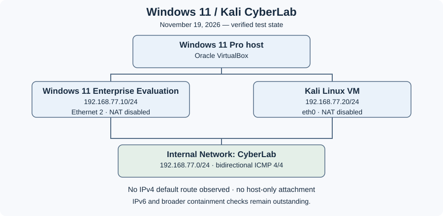

# Cybersecurity Virtual Lab Environment

**Project status:** Windows 11 / Kali CyberLab network verified November 19, 2026; historical Windows 10 investigation remains open · **Started:** October 2026  
**Context:** Controlled cybersecurity laboratory and related hands-on technical investigations

**Portfolio overview:** [View the portfolio overview](PORTFOLIO-OVERVIEW.md).

**Project index:** [Published projects and open investigations](docs/project-index.md) — case studies and technical status.

**Current priority:** Preserve and document the verified Windows 11 / Kali internal-network baseline, finish remaining isolation evidence, and prepare a controlled security-event investigation.

## Current primary lab: Windows 11 + Kali (transition verified November 19, 2026)

I moved away from the original Windows 10 VM as my primary Windows testing guest after recurring severe performance and responsiveness problems. The replacement Windows 11 Enterprise Evaluation guest is now paired with Kali Linux on the `CyberLab` internal network. Bidirectional ICMP connectivity was verified with NAT disabled; comprehensive isolation and IPv6 checks remain outstanding. This was a **change of primary guest**, not a proven repair of the historical Windows 10 issue or confirmation that its VM files were deleted. [Configuration, tests, and limitations](docs/windows11-kali-cyberlab-validation-2026-11-19.md).

## Overview

I built this virtual cybersecurity lab on a Windows 11 laptop using Oracle VirtualBox. The earlier Windows 10 and Kali guests are retained as troubleshooting history. On November 19, 2026, I installed and booted a Windows 11 guest and verified bidirectional network communication with Kali on a separate internal CyberLab network. The prior Windows 10 performance investigation remains unresolved. [Read the verified Windows 11 / Kali lab report](docs/windows11-kali-cyberlab-validation-2026-11-19.md).

I document configuration changes, validation results, network observations, and troubleshooting while keeping guest changes separate from the primary Windows environment.

> **Scope:** The core of this repository documents the virtualized cybersecurity lab. A separate personal-endpoint packet-analysis case study is linked below as related networking practice, not as VirtualBox guest testing or an assessment of campus infrastructure. The Ubuntu WSL 2 baseline assessment, home Pi-hole infrastructure and OctoPi retrospective are distinct projects.

## Environment

| Component | Configuration / role |
|---|---|
| Host | HP EliteBook 840 G8 running Windows 11 Pro |
| Hypervisor | Oracle VirtualBox |
| Historical guest VM (superseded as primary) | Windows 10 — retained in documentation for unresolved performance troubleshooting; disk deletion not verified |
| Current guest VM | Kali Linux — paired with Windows 11 on `CyberLab` |
| Current Windows guest VM (November 19 verified) | Windows 11 Enterprise Evaluation — desktop boot, Guest Additions display resize, NAT connectivity and bidirectional Kali connectivity verified |
| Lab networking | **Current Windows 11 / Kali:** Internal Network `CyberLab`, Windows `192.168.77.10/24`, Kali `192.168.77.20/24`; bidirectional ping verified with NAT disabled and no default IPv4 route observed. [New validation report](docs/windows11-kali-cyberlab-validation-2026-11-19.md). **Historical Windows 10 / Kali:** `soc-lab`, `172.20.20.0/24`, connectivity untested in the earlier [worksheet](docs/lab-network-validation.md) |
| Related investigation tools | Wireshark, PowerShell, Linux terminal, Python (Visual Studio Code) |

Tool usage varies by documented investigation.

## Current CyberLab network architecture (November 19)

Both guests exchanged four successful ICMP replies in each direction with NAT disabled. Neither guest had an IPv4 default route in the tested state. IPv6 and broader containment checks remain outstanding. [Validation report](docs/windows11-kali-cyberlab-validation-2026-11-19.md).

The earlier Windows 10 / Kali `soc-lab` configuration and its historical topology diagram are preserved in the [November 15 network validation worksheet](docs/lab-network-validation.md#configured-topology-not-a-connectivity-claim). Historical guest-to-guest connectivity remains untested.

## Work completed so far

### 1. Create and boot virtual machines

- Installed and configured Windows 10 and Kali Linux virtual machines in Oracle VirtualBox.
- Booted and shut down the Windows 10 VM successfully after troubleshooting the setup.
- Verified Kali Linux could boot after the Windows account and file-permission changes.
- Adjusted allocated resources when the virtual machines were running slowly.

### 2. Configure historical Windows 10 / Kali networking

- Earlier work included a VirtualBox host-only network, but neither of the current guest configurations uses host-only networking as of the November 15 GUI inventory.
- Verified both Windows 10 and Kali Linux have Adapter 1 **NAT**, Adapter 2 **Internal Network (`soc-lab`)**, and disabled Adapters 3–4.
- Verified the adapter-to-interface mappings and routes. Kali's `eth1` is `172.20.20.10/24`; Windows 10's `Ethernet 2` changed from APIPA to `172.20.20.20/24`. I verified the new on-link route and preserved NAT default route. [Full command-level evidence](docs/lab-network-validation.md).
- Explored network addressing and traffic inspection in related laboratory exercises.

**Historical Windows 10 / Kali status:** I have not demonstrated guest-to-guest reachability or effective isolation for this earlier configuration. NAT attachments in that historical configuration mean it was not entirely isolated. Testing is deferred while the VM stability issue remains open.

### 3. Troubleshoot permissions and access

- Worked with Windows account separation as part of the laptop's wider security configuration.
- Corrected access permissions for the Windows 10 VM files when moving between Windows accounts; the recorded file-permission operation reported 16 files processed without failures.
- Confirmed the Kali Linux VM launched under the standard Windows account.

These account and file-permission changes were made on the Windows host.

## Related technical work

Related technical practice covers Wireshark traffic capture and filters, TCP/IP and OSI model interpretation, Linux shell use and Python interpreter work. Documented investigations distinguish completed tests from planned work.

## Related packet-analysis case study

[TCP/TLS Session Analysis — November 3, 2026](docs/tcp-tls-session-analysis-2026-11-03.md) — a controlled, personally generated HTTPS request captured on the Windows laptop's VPN interface, showing TCP connection establishment, TLS 1.3 negotiation and HTTP application-session headers. A separate Firefox service handshake demonstrated a hybrid post-quantum key exchange. This was **endpoint-level observation only**; it does not document or claim testing of campus infrastructure. Raw captures are not publicly shared.

## Historical Windows 10 evidence checklist

Pending evidence is tracked in the [network validation worksheet](docs/lab-network-validation.md):

- [ ] VirtualBox overview showing the two guest machines
- [ ] Each VM successfully booted (with account details cropped)
- [x] Adapter configuration inspected for both VMs and documented in the worksheet (November 15)
- [ ] Sanitized VirtualBox NAT / internal adapter screenshots uploaded
- [x] Guest IP configuration inspected for both VMs; Windows 10 initially had APIPA on its internal adapter
- [x] Windows 10 internal adapter configured as `172.20.20.20/24` and confirmed with `ipconfig`
- [x] Verify Windows 10 updated internal-subnet route and unchanged NAT default route
- [ ] Document guest-to-guest connectivity test
- [x] A troubleshooting note with the symptom, change and verification result
- [x] A high-level diagram of the host and virtual machines

## Technical coverage

**Virtualization · Oracle VirtualBox · Windows 11 and Windows 10 VM configuration · Kali Linux VM setup · NAT and internal networking · Basic network diagnostics · Technical troubleshooting · Documentation**

Project context: controlled laboratory investigations and hands-on troubleshooting. Validation status is recorded alongside each result.

## Next improvements

I am prioritizing evidence quality, privacy review and existing troubleshooting questions before expanding this lab. Historical Windows 10 connectivity testing remains deferred; current CyberLab IPv6 and broader isolation checks and sanitized evidence remain outstanding. I will not label untested connectivity or future packet analysis as completed.

## Related portfolio projects

- [Linux Security Baseline Assessment — Ubuntu WSL 2](https://github.com/bemerson24/ubuntu-wsl2-security-baseline) — separate Linux diagnostics assessment.
- [Raspberry Pi Pi-hole](https://github.com/bemerson24/raspberry-pi-pihole) — DNS filtering, smart-TV query observations and [Windows 11 / WSL2 VPN DNS comparison](https://github.com/bemerson24/raspberry-pi-pihole/blob/main/case-studies/wsl2-bitdefender-pihole-dns-2026-11-15.md) (November 15, 2026; mechanism unresolved).
- [Raspberry Pi 400 — OctoPi 3D Printer Management](https://github.com/bemerson24/raspberry-pi-octopi) — retrospective documentation of a 2020–2024 printer-management setup.

## Security operations roadmap

The [Security Operations Project Roadmap](docs/security-operations-analyst-roadmap.md) tracks planned Windows event-log analysis, PowerShell collection, SIEM/KQL investigations and incident-response documentation. Each milestone specifies the evidence required for completion.

## Professional profile

[Brian Emerson on LinkedIn](https://www.linkedin.com/in/brianemersonpdx/) — professional background, education and career development.

## Windows 11 guest installation — November 19, 2026

**Status update:** Installation completed; desktop boot, Guest Additions display resizing, NAT access and bidirectional internal Kali connectivity were subsequently verified. The paragraph below records the earlier installation-stage troubleshooting. [Full current validation](docs/windows11-kali-cyberlab-validation-2026-11-19.md).

While starting a Windows 11 VM in Oracle VirtualBox, I initially encountered a black console and a UEFI boot message reporting **"No bootable option or device was found."** The console also displayed **"Press any key to boot from CD or DVD"**, indicating the bootable installation media was presented but the short keypress window had elapsed.

**Resolution and verified result:** I restarted the VM and pressed **Spacebar** while the CD/DVD boot prompt was displayed. Windows 11 Setup launched, and installation began.

**Lesson:** A boot failure message does not always indicate a damaged VM or missing ISO. Check the firmware console and boot prompt first; a missed interactive boot selection can produce a no-bootable-device message even when installation media is available.

**Subsequent outcome:** These Windows 11 setup and connectivity checks were completed. The Windows 11 guest joined the **new `CyberLab` network**, not the historical `soc-lab` network. This result does not resolve the separate Windows 10 performance/NEM investigation.

## VirtualBox performance investigation

**Current status (November 15, 2026):** The Windows 10 guest has repeatedly become severely sluggish or unresponsive, including when Kali is powered off and after reducing Windows 10 from four to two vCPUs. On the Windows 11 Pro 26H2 host (build `26300.9974`), VirtualBox `7.2.22r175245` reports NEM fallback and snail execution mode. One affected VM session logged a **244.381-second virtual time-manager catch-up lag**. The specific defect is not established, and I have not changed WSL2, VBS, Memory Integrity or BitLocker as a performance workaround.

- [Read the technical investigation and supporting evidence](docs/lab-network-validation.md)
- [Read my VirtualBox NEM/WHPX compatibility report](docs/virtualbox-nem-whpx-issue-report-2026-11-15.md) — published as [my November 16 contribution to VirtualBox issue #972](https://github.com/VirtualBox/virtualbox/issues/972#issuecomment-6924524139); root cause remains unresolved
- [Read the complete dated troubleshooting history](docs/virtualbox-investigation-history.md) — earlier checks and intermediate hypotheses are retained without cluttering this README

## Windows 11 / Kali isolated network milestone — November 19, 2026

- Windows 11 `192.168.77.10/24` and Kali `192.168.77.20/24` exchanged four successful ICMP echo replies in **both directions**, including after NAT was disabled.
- The Windows inbound ICMPv4 rule is restricted to the Kali source and Windows lab destination addresses.
- Kali's active NetworkManager profile was corrected after disabling NAT caused its internal NIC to appear as `eth0` rather than `eth1`.
- Both guests showed **no IPv4 default route** in the tested state. IPv6 route-check outputs and broader isolation controls still require independent verification; full isolation is **not claimed**.
- I saved final isolated-baseline snapshots of both VMs (reported during setup). Screenshots and command outputs remain subject to privacy review before publication.

[Read the full dated configuration, troubleshooting and evidence record](docs/windows11-kali-cyberlab-validation-2026-11-19.md).
