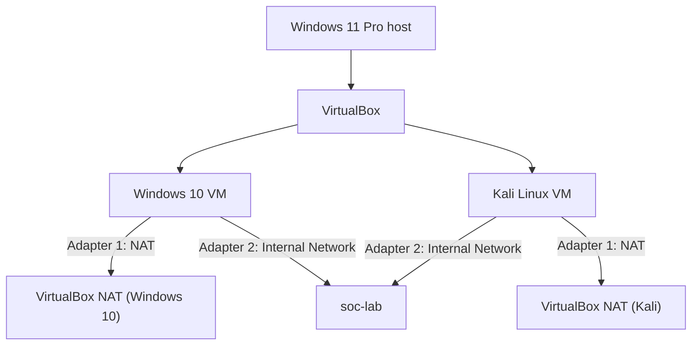

# Virtual Lab — Network Validation Worksheet

**Environment:** Windows 11 Pro host / Oracle VirtualBox / Windows 10 and Kali Linux guests  
**Status (November 15, 2026):** VirtualBox GUI adapter inventory verified for both VMs. Kali Linux addresses, routes and adapter mapping verified. Windows 10 internal `Ethernet 2` has now been assigned `172.20.20.20/24` (formerly APIPA). `ipconfig` confirms the static address, and `route print -4` now confirms the `172.20.20.0/24` on-link route through `172.20.20.20` with the NAT default route preserved via `10.0.2.2`. Guest-to-guest connectivity remains **untested**.

## Goal and scope

Record every enabled VM adapter and its network attachment before making guest changes. Distinguish **configured virtual network membership** from **proven guest connectivity**. This is a personal educational lab; no external systems are in scope.

A host-only network may have been configured earlier, but neither of the two guests currently has an enabled host-only adapter in the November 15 GUI inventory. The observed layout uses **NAT + Internal Network**.

## 1. VirtualBox adapter inventory — verified November 15

Source: four read-only **Settings → Network** screenshots per VM, viewed while both VMs were **Powered Off**.

| Guest | Adapter | Enabled | Attached to | Network name | Adapter type | Virtual cable | Promiscuous mode |
| --- | --- | --- | --- | --- | --- | --- | --- |
| Windows 10 | 1 | Yes | NAT | N/A | Intel PRO/1000 MT Desktop (82540EM) | Connected | Deny (field inactive for NAT) |
| Windows 10 | 2 | Yes | Internal Network | `soc-lab` | Intel PRO/1000 MT Desktop (82540EM) | Connected | Deny |
| Windows 10 | 3 | No | Not attached | N/A | N/A (disabled) | N/A | N/A |
| Windows 10 | 4 | No | Not attached | N/A | N/A (disabled) | N/A | N/A |
| Kali Linux | 1 | Yes | NAT | N/A | Intel PRO/1000 MT Desktop (82540EM) | Connected | Deny (field inactive for NAT) |
| Kali Linux | 2 | Yes | Internal Network | `soc-lab` | Intel PRO/1000 MT Desktop (82540EM) | Connected | Deny |
| Kali Linux | 3 | No | Not attached | N/A | N/A (disabled) | N/A | N/A |
| Kali Linux | 4 | No | Not attached | N/A | N/A (disabled) | N/A | N/A |

The screenshots display VirtualBox MAC addresses; these identifiers are intentionally **not transcribed** here. Original screenshots were reviewed during the session, but **sanitized screenshots have not yet been uploaded** to GitHub.

### Configured topology, not a connectivity claim



The diagram reflects configured attachment modes only. NAT permits potential outside connectivity under normal operation; actual connectivity was not tested during this inventory. Internal-network membership does not establish successful guest-to-guest communication. The host is not shown as a participant in `soc-lab`.

## 2. Collect current guest addressing — partially complete

Because Windows 10 previously experienced intermittent responsiveness problems, do not rush to launch multiple VMs or change their network settings just to complete the worksheet. Preserve the existing snapshots and virtual disks.

Once a guest can be safely started, collect its current addressing and routing in a read-only way.

Windows 10 PowerShell:

```powershell
ipconfig /all
route print
```

Kali Linux terminal:

```bash
ip -br addr
ip route
```

Record actual interface-to-adapter mapping and current addressing rather than copying historical IP addresses from earlier sessions. Do not publish usernames, MAC addresses or other unnecessary host identifiers.

### Kali Linux — observed November 15

The following output was collected from the running Kali VM:

- `ip -br addr`: `eth0` UP with `10.0.2.15/24`; `eth1` UP with `172.20.20.10/24`; loopback `127.0.0.1/8`.
- `ip route`: default route via `10.0.2.2` on `eth0`; connected route `10.0.2.0/24` on `eth0`; connected route `172.20.20.0/24` on `eth1`.

Routing, subnet and MAC evidence now agree. The current host-side `VBoxManage showvminfo "Kali" --machinereadable` output was compared privately with Kali's `ip -br link` output on November 15: `macaddress1` matches `eth0`, and `macaddress2` matches `eth1`. Therefore Adapter 1 is confirmed as Kali's NAT interface (`eth0`), and Adapter 2 is confirmed as the `soc-lab` interface (`eth1`). MAC values are not published here.

| Guest | Observed interfaces and addresses | Evidence | Status |
| --- | --- | --- | --- |
| Windows 10 | `Ethernet` (NAT): `10.0.2.15/24`, gateway `10.0.2.2`; `Ethernet 2` (`soc-lab`): **now `172.20.20.20/24`**, no default gateway (initially APIPA `169.254.206.116/16`) | Before: `ipconfig /all`, `route print -4`; after: `ipconfig` and `route print -4` screenshots, November 15 | Static IPv4 applied; on-link `172.20.20.0/24` route and unchanged NAT default route verified; guest connectivity pending |
| Kali Linux | `eth0`: `10.0.2.15/24`; `eth1`: `172.20.20.10/24` | `ip -br addr`, `ip route`, `ip -br link`, and host-side `VBoxManage showvminfo` output, November 15 | Both interface MACs matched to their respective VirtualBox adapters; Adapter 1 / NAT = `eth0`, Adapter 2 / `soc-lab` = `eth1` |

### Windows 10 — observed November 15

From the running Windows 10 guest, I collected `ipconfig /all` and `route print -4` in Command Prompt.

- `Ethernet`, matching VirtualBox Adapter 1 (NAT) by MAC: DHCP-enabled, `10.0.2.15/24`, default gateway `10.0.2.2`. The route table confirms the default route through this interface.
- `Ethernet 2`, matching VirtualBox Adapter 2 (`soc-lab`) by MAC: DHCP-enabled, automatically configured IPv4 address `169.254.206.116/16` (APIPA), without an IPv4 default gateway. The route table shows on-link `169.254.0.0/16`, not `172.20.20.0/24`.
- This suggests no usable DHCP-provided address was obtained for the internal interface during the observation. It does not establish the cause or prove the underlying internal link failed. Kali's intended internal subnet is `172.20.20.0/24`, so Windows 10 is not yet addressed on that subnet.
- **Follow-up configuration and verification, November 15:** In the Windows 10 guest, I set only `Ethernet 2` to `172.20.20.20`, subnet mask `255.255.255.0`, with blank IPv4 gateway and DNS. The subsequent `ipconfig` output showed `Ethernet` unchanged at `10.0.2.15/24` with gateway `10.0.2.2` and `Ethernet 2` now at `172.20.20.20/24`, with no default gateway displayed. This establishes the configured address, not successful communication with Kali. An updated `route print -4` output confirmed `172.20.20.0` mask `255.255.255.0` as On-link through interface `172.20.20.20`. The default route remained `0.0.0.0/0` via `10.0.2.2` using `10.0.2.15`. No guest-to-guest ping has yet been performed.

## 3. Test only authorized internal-lab endpoints — pending

After both guest addresses and the `soc-lab` interface mapping are verified, perform a narrowly scoped reachability test on the **internal-network interfaces**, not by assuming that a successful NAT connection proves guest-to-guest reachability.

Windows 10:

```powershell
ping <verified-kali-internal-ip>
```

Kali Linux:

```bash
ping -c 4 <verified-windows10-internal-ip>
```

These are **planned commands**, not executed results. Failure could reflect IP configuration, local firewall/ICMP filtering or another guest issue. Only tests actually executed will be marked successful or failed.

| Source guest | Destination guest | Intended interface | Actual result | Evidence |
| --- | --- | --- | --- | --- |
| Windows 10 | Kali Linux | `soc-lab` | Not tested | Pending |
| Kali Linux | Windows 10 | `soc-lab` | Not tested | Pending |

## 4. Evidence and completion checklist

- [x] Windows 10: all four VirtualBox adapters inspected
- [x] Kali Linux: all four VirtualBox adapters inspected
- [x] Configured NAT and internal-network attachments documented
- [x] Earlier host-only-only description reconciled against current GUI configuration
- [ ] Sanitized adapter screenshots uploaded (MAC addresses must be redacted)
- [x] Windows 10 initial addressing and routes recorded; `Ethernet 2` APIPA identified
- [x] Windows 10 internal adapter assigned `172.20.20.20/24` without a gateway; post-change `ipconfig` confirmed
- [x] Updated Windows 10 IPv4 route table verified after the static-address change
- [x] Kali `eth0` MAC matched to VirtualBox Adapter 1 (NAT) using current host-side `VBoxManage` output
- [x] Kali `eth1` MAC matched to VirtualBox Adapter 2 (`soc-lab`) using current host-side `VBoxManage` output
- [ ] Guest-to-guest connectivity tested and logged
- [ ] Any security or isolation conclusions based on actual tests, not configuration alone

## Performance observation — November 15, 2026

With both guests running, I observed increased fan activity and potential Windows 10 sluggishness. The Windows 11 host Task Manager showed approximately 21% total CPU use and 78% memory use, with one VirtualBox process group using roughly 8.4 GB of memory and another roughly 1.9 GB. These host metrics alone do **not** diagnose the source of the performance issue.

A subsequent read-only host command inspected the current Windows 10 VM log:

```powershell
& "C:\Program Files\Oracle\VirtualBox\VBoxManage.exe" showvminfo "Windows 10" --log 0 |
    Select-String 'HMR3Init|NEMR3Init|Snail execution mode'
```

The log included:

```text
00:00:06.184584 HM: HMR3Init: Attempting fall back to NEM: VT-x is not available
00:00:06.209107 NEM: NEMR3Init: Snail execution mode is active!
```

**Verified:** This Windows 10 VM session used VirtualBox's NEM fallback and reported snail execution mode. The log does not independently identify which Windows host component prevented VirtualBox from accessing VT-x or quantify the performance penalty.

**Follow-up observation:** While both Windows 10 and Kali were running, Windows 10 became unresponsive even to a Ctrl+Alt+Delete attempt. I then cleanly shut down Kali; VirtualBox Manager showed Kali **Powered Off** and Windows 10 **Running**. As soon as Kali stopped, Windows 10 responded and processed previously queued commands. This strongly associates the stall with simultaneous VM load, but does not isolate RAM pressure, scheduling, NEM overhead or another cause. Any queued ping that may have executed only after Kali shut down would **not** validate live guest-to-guest connectivity; no valid simultaneous-guest ping result has been captured.

**Recovery completion:** After Kali powered off, Windows 10 recovered responsiveness and subsequently completed a normal guest-initiated shutdown. I confirmed VirtualBox Manager showed **both VMs Powered Off**. This successful shutdown corroborates recovery after load was reduced; it does not demonstrate that the underlying NEM performance problem was repaired.

**Host memory comparison after both VMs were powered off:** A subsequent Windows 11 Task Manager Processes screenshot showed **11% CPU** and **44% memory** usage; Firefox remained open, using approximately **2.8 GB**. This compares with the earlier **21% CPU / 78% memory** observation while both guests were running. Memory usage was **34 percentage points lower** with both guests off, supporting the presence of significant combined VM memory load. The observations were collected at different times with potentially different host activity; they are not a controlled benchmark and do not isolate the cause of the stall.

**Detailed idle-state memory snapshot (Task Manager → Performance → Memory):** With both VMs off, Windows 11 showed **32.0 GB DDR4 installed**, **31.7 GB usable**, **13.5 GB in use (43%)**, **18.2 GB available**, **16.8/33.7 GB committed**, **6.8 GB cached**, and **1.2 GB compressed**. Two of two SODIMM slots were used. These values confirm ample available RAM *after* VM shutdown and cannot retrospectively establish an out-of-memory condition while both guests were running. The earlier 78% measurement showed elevated utilization but not memory exhaustion.

**VirtualBox resource allocation inspection (read-only; both VMs off):** `VBoxManage showvminfo ... --machinereadable` reported Windows 10 `memory=8192` (8 GB) and `cpus=4`; Kali `memory=4096` (4 GB) and `cpus=2`. Total configured VM guest RAM is **12 GB**, with **six vCPU allocations** across the two guests. Six vCPUs is not a measured host CPU utilization value or necessarily six dedicated physical cores. The configured guest RAM is consistent with a substantial increase in host memory usage when both VMs run, but it does not establish physical memory exhaustion or isolate the cause of NEM snail mode. Host physical/logical core counts have not yet been measured in this step.

**Host processor topology (read-only, Windows 11 PowerShell):** `Get-CimInstance Win32_Processor | Select-Object Name, NumberOfCores, NumberOfLogicalProcessors` returned **Intel Core i7-1185G7**, **4 physical cores**, **8 logical processors**. The VMs have 4 (Windows 10) and 2 (Kali) vCPUs configured. These are schedulable virtual processors, not dedicated physical cores, and the allocation alone does not establish CPU exhaustion. Oracle VirtualBox 7.2's [processor settings guidance](https://docs.oracle.com/en/virtualization/virtualbox/7.2/user/working-with-vms.html) advises not configuring more guest vCPUs *per VM* than physical cores. A **controlled diagnostic** was planned to reduce the Windows 10 VM from 4 to 2 vCPUs, without changing the host's security settings. **Subsequent execution:** I started Windows 10 after applying the two-vCPU configuration, reported a fast boot, and confirmed `echo %NUMBER_OF_PROCESSORS%` returned `2` within the guest. Kali remained powered off. These observations verify the new guest CPU count and responsiveness for this brief single-VM check; they are not a timed benchmark or evidence that the prior two-VM freeze was solved. **Post-change NEM verification:** In the new Windows 10 session configured with 2 vCPUs, the host-side `VBoxManage showvminfo "Windows 10" --log 0` output again contained:

```text
00:00:06.226968 HM: HMR3Init: Attempting fall back to NEM: VT-x is not available
00:00:06.251973 NEM: NEMR3Init: Snail execution mode is active!
```

This confirms that reducing the guest vCPUs from 4 to 2 **did not remove NEM fallback or snail execution mode**. I initially reported a fast boot and a responsive command prompt, then subsequently reported that **Windows 10 became sluggish again with Kali still powered off**. Therefore the two-vCPU adjustment did not produce sustained single-VM responsiveness. **Recovery in this session:** With Windows 10 unresponsive and Kali powered off, I ran `VBoxManage controlvm "Windows 10" acpipowerbutton` from the Windows 11 host. I observed that the ACPI power-button request was followed by the guest becoming responsive enough to initiate a normal shutdown, which completed; Windows 10 is now closed. This is a successful recovery observation, **not** evidence that ACPI corrected the NEM fallback or underlying slowdown. The precise relationship between the ACPI signal and resumed responsiveness is not isolated. No forced power-off or snapshot operation was used. This result weakens the earlier interpretation that a second running guest is necessary to trigger the symptoms. The specific mechanism remains unresolved.

The **only later VM configuration change** documented here was reducing Windows 10 from 4 to 2 vCPUs. No snapshots, network settings, Windows host hypervisor settings, WSL2, VBS, Memory Integrity, BitLocker or other host security protections were altered. The guest-to-guest connectivity check remains **unverified**.

## Host virtualization-based security — read-only inspection (November 15, 2026)

With both guests shut down, I ran:

```powershell
Get-CimInstance -ClassName Win32_DeviceGuard -Namespace root\Microsoft\Windows\DeviceGuard |
    Select-Object VirtualizationBasedSecurityStatus, SecurityServicesRunning
```

**Recorded result:** `VirtualizationBasedSecurityStatus = 2`; `SecurityServicesRunning = {2, 3, 4}`.

According to [Microsoft's Win32_DeviceGuard documentation](https://learn.microsoft.com/en-us/windows/security/hardware-security/enable-virtualization-based-protection-of-code-integrity), status `2` means VBS is running; the active service codes are **Memory Integrity/HVCI (2)**, **System Guard Secure Launch (3)**, and **SMM Firmware Measurement (4)**. Credential Guard (code 1) was not included in the returned list; this check does not independently assess every other Windows security component.

Microsoft and Oracle document the risk of slower VirtualBox execution when Windows hypervisor-based functionality is active. These findings support a *Windows hypervisor / VirtualBox compatibility* explanation for the logged NEM fallback, but the exact feature or mechanism producing the severe stall was not independently isolated. **No security feature, boot setting, or optional Windows feature was modified.**

## Windows optional-feature inventory (read-only; November 15, 2026)

Without elevated PowerShell, the host query `Get-CimInstance Win32_OptionalFeature` filtered for `HypervisorPlatform`, `VirtualMachinePlatform`, and `Microsoft-Hyper-V-All`. Recorded values:

| Windows optional feature | InstallState | Interpretation |
| --- | ---: | --- |
| `VirtualMachinePlatform` | `1` | Enabled |
| `HypervisorPlatform` | `2` | Disabled |
| `Microsoft-Hyper-V-All` | `2` | Disabled |

[Microsoft's Win32_OptionalFeature reference](https://learn.microsoft.com/en-us/windows/win32/cimwin32prov/win32-optionalfeature) defines `InstallState=1` as enabled and `2` as disabled. The earlier VBS results show that Windows hypervisor-based protections are nevertheless running; the Hyper-V optional-feature state alone does **not** establish that the hypervisor is absent.

The [Oracle VirtualBox 7.2 manual, "Using Hyper-V with Oracle VirtualBox"](https://docs.oracle.com/en/virtualization/virtualbox/7.2/user/AdvancedTopics.html) says Windows Hypervisor Platform must be enabled for the documented Hyper-V compatibility path, and warns of possible significant performance degradation. **Follow-up log inspection:** The next read-only `VBoxManage showvminfo "Windows 10" --log 0` filter showed:

```text
00:00:06.226968 HM: HMR3Init: Attempting fall back to NEM: VT-x is not available
00:00:06.248922 NEM:  info: Found optional import WinHvPlatform.dll!WHvQueryGpaRangeDirtyBitmap.
...
00:00:06.249171 NEM: WHvCapabilityCodeHypervisorPresent is TRUE, so this might work...
00:00:06.249181 NEM: WHvCapabilityCodeExtendedVmExits      = 0x0000000000007fff
00:00:06.249271 NEM: WHvCapabilityCodeFeatures             = 0x00000000000002ff
```

The `Found optional import` lines are **informational discovery, not error messages**. A successful hypervisor-presence capability query and reported capability values show that VirtualBox could interact with some Windows hypervisor APIs **despite** `HypervisorPlatform=2` in the optional-feature inventory. This **weakens** the earlier inference that a disabled Windows Hypervisor Platform feature alone explains the freezes. The command output was limited to its *first 35 matches*, and does not show a complete NEM initialization outcome, partition-creation outcome, or freeze-specific error. **Do not treat enabling the optional feature as a validated remedy.** No host or VM settings were modified.

Further diagnosis should use existing logs and other read-only checks first.

## Windows 10 VM timing-stall evidence (November 15, 2026)

A read-only host query searched the latest Windows 10 VM log for `Giving up catch-up|lag|heartbeat|WHvCreatePartition|WHvSetupPartition|NEMR3Init|VERR_` and returned the last 30 matches. The standout record was:

```text
00:09:53.449479 TM: Giving up catch-up attempt at a 244 381 120 090 ns lag; new total: 244 381 120 090 ns
```

The `TM` time manager recorded **244.381120090 seconds (approximately 4 minutes 4 seconds) of virtual-clock catch-up lag** roughly 9 minutes 53 seconds into the session. This is direct evidence of a major timing discrepancy, **not proof the Windows guest was continuously frozen for that exact duration or proof of which subsystem caused it**. At roughly `00:10:25` the matched output contained CPU register/state entries; those entries alone are not evidence of a guest crash. The displayed `/PDM/CritSects/...VERR_INTERRUPTED` and `...VERR_TIMEOUT` counters were zero. `vmmR3LogFlusher: Terminating (VERR_OBJECT_DESTROYED)` appeared at the end and is not sufficient evidence of a VM failure. These selected matches do not establish absence of other errors elsewhere in the log.

**External comparison (not assumed same root cause):** [VirtualBox upstream issue #837, opened August 28, 2026](https://github.com/VirtualBox/virtualbox/issues/837) describes a Windows 11 host / Windows 10 guest using NEM/WHPX and exhibiting a 114-second guest stall with the same `TM: Giving up catch-up attempt` log signature. The other reporter saw no comparable stalls after testing with direct native VT-x, but that change involved disabling Windows virtualization protections and is **not a proposed change for this machine**. Different VirtualBox builds, environments and validation periods limit comparisons. This report supports investigating NEM/WHPX timing behavior, not a confirmed diagnosis or workaround.

**Step 36 — ACPI shutdown correlation (read-only):** The subsequent filtered log output showed the following event sequence from the same VM run:

```text
00:00:07.298409 Changing the VM state from 'CREATING' to 'CREATED'
00:00:07.299755 Changing the VM state from 'CREATED' to 'POWERING_ON'
00:00:07.300047 Changing the VM state from 'POWERING_ON' to 'RUNNING'
00:09:53.449479 TM: Giving up catch-up attempt at a 244 381 120 090 ns lag; new total: 244 381 120 090 ns
00:10:25.115019 ACPI: Entering S5 power state (power down)
00:10:25.115120 Changing the VM state from 'RUNNING' to 'POWERING_OFF'
00:10:25.122631 Changing the VM state from 'POWERING_OFF' to 'OFF'
00:10:25.129598 Changing the VM state from 'OFF' to 'DESTROYING'
00:10:25.328314 Changing the VM state from 'DESTROYING' to 'TERMINATED'
```

This confirms the large virtual time lag was logged **before** the guest entered ACPI S5 and transitioned normally through power-off to termination, consistent with my observation of a successful shutdown after an ACPI power-button request. The log does not independently prove the power-button signal restored guest responsiveness. No `Guest seems to be unresponsive` or `GuestHeartBeat` entries appeared in the filtered output; **absence from these matches does not demonstrate that Guest Additions or guest-heartbeat monitoring was operational or healthy**.

**Step 37 — Local context surrounding the lag:** The `Select-String 'Giving up catch-up attempt' -Context 12,12` command returned nearby log records, not a continuous activity trace. The 12 preceding records included WASAPI audio-cache initialization and a warning at `00:01:17` (with unusual scheduling numbers), medium-enumeration completion at `00:01:30` and `00:06:51`; the lag followed at `00:09:53.449479`. Later records included an IPv6 MTU/RDNSS warning at `00:09:55.719661`, WASAPI cache lookups at `00:09:56` and `00:10:14`, and orderly USB/audio shutdown and ACPI S5 at `00:10:25`. **None of these warnings has a verified causal relationship with the 244.381-second lag**; notably, the IPv6 warning was logged after the time-manager event. Gaps between log records do not independently establish continuous guest unresponsiveness.

**Step 38 — Log wall-clock anchor and host-event correlation:** The latest host-side read-only query returned:

```text
00:00:05.958534 Log opened 2026-11-16T00:38:49.946606300Z
```

Using that point as an anchor rather than assuming relative time zero equals log opening, the `00:09:53.449479` time-manager lag corresponds approximately to **2026-11-16 00:48:37.437551 UTC** (November 15, 2026, 16:48:37 PST). The `00:10:25.115019` ACPI S5 transition corresponds approximately to **00:49:09.103091 UTC** (16:49:09 PST). These are *estimated correlations*, not independently measured host freeze start/end times: the VM timestamps and elapsed-time logging under NEM may themselves have anomalies. **Step 39 — Host System event correlation (read-only):** I ran `Get-WinEvent -FilterHashtable` against the Windows 11 `System` log using `StartTime` and `EndTime` three minutes before and after the estimated lag, filtering critical/error/warning levels `@(1,2,3)` and limiting displayed results to 25. **No entries were returned.** This means the filtered command displayed no matches; it does **not** rule out VirtualBox or Windows hypervisor failures, informational host events, another event channel, or timing mismatch. Because the query used `-ErrorAction SilentlyContinue`, a query/access error was also suppressed. The next diagnostic must first verify read access to the `System` event log without suppressing errors.

Keep both VMs powered off and preserve WSL2, VBS, BitLocker, snapshots and security settings.

## Step 40 — Verify host System event-log read access

A read-only, non-elevated PowerShell command queried the most recent Windows 11 `System` event using `Get-WinEvent -LogName System -MaxEvents 1 -ErrorAction Stop` and returned **Microsoft-Windows-HttpService, Event ID 113, Information, November 15, 2026 17:49:33 PST**. This confirms that the current Windows user can read the host `System` log; the Step 39 empty result was **not explained by a general lack of read access**.

The Step 39 query searched only event severity levels **1, 2 and 3** (critical/error/warning) and found no displayed results within ±3 minutes of the estimated 16:48:37 PST timing event. It did not include Information-level events or other log channels. To avoid equating an empty severity-filtered result with a quiet host, the next read-only check will query all levels in the same narrow time window.

## Step 41 — All-level Windows System event correlation

After verifying the Windows 11 System event log was readable, I reran the ±3-minute host-event query centered on approximately **November 15, 2026 16:48:37 PST** without the earlier critical/error/warning level filter. Two events were returned:

| Host local timestamp (PST) | Provider | Event ID | Level |
| --- | --- | ---: | --- |
| 2026-11-15 16:48:38 | Service Control Manager | 7040 | Information |
| 2026-11-15 16:50:54 | Service Control Manager | 7040 | Information |

Event ID **7040** is associated with changes to a Windows service's start type. The first timestamp is approximately one second after the **estimated** VM log-time correlation at 16:48:37, but the host events **cannot be causally connected to the VM timer lag** on timestamp proximity alone. The services, old/new start types and any initiating process are not present in this abbreviated event table. The service names and old/new start types were subsequently checked in Step 42 below. No configuration changes were made; guests remain powered off.

## Step 42 — Identify Service Control Manager 7040 events

A read-only host query retrieved full System event messages for the two Event ID 7040 records:

```text
2026-11-15 16:48:38 PST: The start type of the Background Intelligent Transfer Service service was changed from demand start to auto start.
2026-11-15 16:50:54 PST: The start type of the Background Intelligent Transfer Service service was changed from auto start to demand start.
```

Both events concern **Background Intelligent Transfer Service (BITS)** and show its start configuration changing **Manual → Automatic → Manual** within 2 minutes 16 seconds. BITS supports background file transfers used by Windows and applications, including some Windows Update tasks. These events **do not establish any specific transfer, process that initiated the changes, or causal relationship** with the Windows 10 guest stall. The first BITS event occurred about one second after the **estimated** VirtualBox time-manager lag timestamp, while `NEM: Snail execution mode is active!` had already been logged at startup. The available System event evidence provides **no specific host warning or error to explain the lag**.

The current lab state remains Windows 10 and Kali both powered off, Windows 10 configured with two vCPUs, existing snapshots and host security protections preserved. The primary unresolved problem is significant NEM/Windows hypervisor execution degradation, not demonstrated BITS failure. Optional read-only investigation could compare Windows Update and BITS operational logs around this period, but such a correlation would not by itself resolve the VirtualBox compatibility issue.

## Step 43 — Windows Update event correlation and BITS lead closure

I ran the read-only `Get-WinEvent` query against `Microsoft-Windows-WindowsUpdateClient/Operational` for the same estimated ±3-minute window (2026-11-15 16:45:37–16:51:37 PST). PowerShell returned `NoMatchingEventsFound`, indicating **no matching Windows Update operational events were returned** for this interval. The command used `-ErrorAction Stop` and surfaced the no-matching-events error rather than suppressing it. This does not prove no Windows Update activity occurred outside this channel or interval.

**BITS lead closed as inconclusive:** The two host System 7040 informational events at 16:48:38 and 16:50:54 PST reflected BITS startup-type changes, but no transfer activity, initiating process, or causal link to VirtualBox's earlier NEM fallback or reported 244.381-second time-manager lag was verified. Continue the investigation with the **VirtualBox NEM execution path**, not the BITS/Windows Update hypothesis. Both VMs should remain off; do not disable WSL2, VBS, BitLocker, or other host protections.

## Step 44 — NEM partition initialization outcome

A host-only query of the last 45 `NEM:` / `HMR3Init` matches in the Windows 10 VM log confirmed:

```text
00:00:06.251874 NEM: Created partition 0000022d8fbd8f10. APIC emulation mode: VirtualBox
00:00:06.251973 NEM: NEMR3Init: Snail execution mode is active!
00:00:06.251973 NEM: Note! VirtualBox is not able to run at its full potential in this execution mode.
00:00:06.256177 NEM: Successfully set up partition (device handle 0000000000000df5, partition ID 0x0)
00:10:25.148302 NEM: Destroying partition 0000022d8fbd8f10 with its 2 VCpus...
```

The same log also enumerates `WHvCapabilityCodeVmx*` and other hypervisor capabilities. These lines **confirm a successful NEM/Windows hypervisor partition initialization for a two-vCPU guest**, not an initialization failure. The partition was subsequently destroyed during the previously verified orderly shutdown. They do **not** establish that every execution stage is healthy or identify what triggered the 244.381-second virtual timer lag and repeated guest responsiveness failures.

VirtualBox explicitly cautions that full performance is unavailable in its selected execution mode. [Oracle's VirtualBox 7.2 troubleshooting guidance](https://docs.oracle.com/en/virtualization/virtualbox/7.2/user/Troubleshooting.html) warns about poor performance with Hyper-V-based host protections, but suggests disabling Windows features; that is **outside this lab's security-preservation constraints**, and **not an action taken or recommended here**. Keep VBS, HVCI/Memory Integrity, WSL2, BitLocker and existing snapshots unchanged. A better follow-up is to capture exact host OS build information for a reproducible upstream compatibility report or a supported software remediation assessment.

## Step 45 — Host operating system build inventory

A read-only, non-elevated `Get-CimInstance Win32_OperatingSystem | Select-Object Caption, Version, BuildNumber` returned:

```text
Caption                  Version    BuildNumber
Microsoft Windows 11 Pro 10.0.26300 26300
```

This establishes **Windows 11 Pro, OS build family 26300**. [Microsoft's Windows 11 release information](https://learn.microsoft.com/en-us/windows/release-health/windows11-release-information) maps the 26300 family to **Windows 11 version 26H2** (GA beginning September 29, 2026). The CIM query alone does not show `UBR` or prove Insider enrollment.

## Step 46 — Exact Windows build revision

A subsequent read-only `Get-ItemProperty 'HKLM:\SOFTWARE\Microsoft\Windows NT\CurrentVersion'` check returned `DisplayVersion=26H2`, `CurrentBuild=26300`, `UBR=9974`, and `BuildLabEx=26100.1.amd64fre.ge_release.240331-1435`. The installed Windows 11 Pro build is **26300.9974**; the older base build value in `BuildLabEx` is build-lineage metadata, not the current update revision. No OS settings changed.

**Relevant fresh upstream comparison (retrieved November 15, 2026):** [VirtualBox GitHub issue #972](https://github.com/VirtualBox/virtualbox/issues/972) was opened November 10, 2026 for recurring NEM/WHPX freezes on a Windows 11 25H2 host with Memory Integrity enabled. A separate commenter reports similar freezes specifically on **26H2**. This is a **user-reported**, not vendor-confirmed, comparison; their host architecture, guest versions, logs and configuration differ. Unlike a verified fix, issue #972 provides evidence the symptom category is being reported by other users while VBS remains enabled. Also compare [issue #837](https://github.com/VirtualBox/virtualbox/issues/837), which previously recorded a similar time-manager catch-up lag.

**Current release check:** [Oracle's downloads page](https://www.oracle.com/virtualization/technologies/vm/downloads/virtualbox-downloads.html) lists **7.2.22** as its latest release on the date checked, matching the VirtualBox version already observed on this lab host. Do not recommend upgrading to a version not released. Confirm the installed binary's exact revision with a read-only `VBoxManage --version` query when preparing a reproducible issue report. Neither external comparison establishes this machine's precise root cause or an approved workaround.

## Step 47 — Exact installed VirtualBox binary version

I ran the installed `VBoxManage.exe --version` from the Windows 11 host, without elevation. Output:

```text
7.2.22r175245
```

The installed Oracle VirtualBox version is **7.2.22**, **revision 175245**. This independently verifies the version assumed in the earlier investigation and completes the core software/hardware inventory for a reproducible NEM/WHPX performance report: Windows 11 Pro 26H2 build 26300.9974, Intel Core i7-1185G7 (4 physical/8 logical processors), active VBS/HVCI, Virtual Machine Platform enabled, Windows 10 VM 8 GiB and 2 vCPUs after a controlled reduction from 4, NEM partition successfully created, snail execution mode active, recurring single-guest freezes, and a recorded 244.381-second virtual-clock catch-up lag. **The specific defect remains unresolved.**

The two VMs remain shut down. The next useful work is to prepare a concise, sanitized compatibility report for review before upstream submission, not to repeat performance experiments or disable host security features.

## Next action

With both guests off and the timer-lag evidence captured, verify the exact VirtualBox binary revision with `VBoxManage --version` and maintain a sanitized, reproducible NEM/WHPX issue summary. Do not run a dual-VM connectivity test until guest stability is addressed. Preserve host WSL2, VBS/HVCI, BitLocker, existing snapshots and VM disk chains; no unverified host-security or guest hardware changes.
