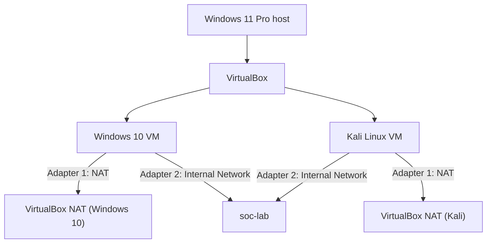

# Virtual Lab — Network Validation Worksheet

**Environment:** Windows 11 Pro host / Oracle VirtualBox / Windows 10 and Kali Linux guests  
**Status (November 15, 2026):** VirtualBox GUI adapter inventory verified for both VMs. Kali Linux addresses, routes and adapter mapping verified. Windows 10 internal `Ethernet 2` has now been assigned `172.20.20.20/24` (formerly APIPA). `ipconfig` confirms the static address, and `route print -4` now confirms the `172.20.20.0/24` on-link route through `172.20.20.20` with the NAT default route preserved via `10.0.2.2`. Guest-to-guest connectivity remains **untested**.

## Goal and scope

Record every enabled VM adapter and its network attachment before making guest changes. Distinguish **configured virtual network membership** from **proven guest connectivity**. This is a personal educational lab; no external systems are in scope.

A host-only network may have been configured earlier, but neither of the two guests currently has an enabled host-only adapter in the November 15 GUI inventory. The observed layout uses **NAT + Internal Network**.

## 1. VirtualBox adapter inventory — verified November 15

Source: four read-only **Settings → Network** screenshots per VM, viewed while both VMs were **Powered Off**.

| Guest | Adapter | Enabled | Attached to | Network name | Adapter type | Virtual cable | Promiscuous mode |
| --- | --- | --- | --- | --- | --- | --- | --- |
| Windows 10 | 1 | Yes | NAT | N/A | Intel PRO/1000 MT Desktop (82540EM) | Connected | Deny (field inactive for NAT) |
| Windows 10 | 2 | Yes | Internal Network | `soc-lab` | Intel PRO/1000 MT Desktop (82540EM) | Connected | Deny |
| Windows 10 | 3 | No | Not attached | N/A | N/A (disabled) | N/A | N/A |
| Windows 10 | 4 | No | Not attached | N/A | N/A (disabled) | N/A | N/A |
| Kali Linux | 1 | Yes | NAT | N/A | Intel PRO/1000 MT Desktop (82540EM) | Connected | Deny (field inactive for NAT) |
| Kali Linux | 2 | Yes | Internal Network | `soc-lab` | Intel PRO/1000 MT Desktop (82540EM) | Connected | Deny |
| Kali Linux | 3 | No | Not attached | N/A | N/A (disabled) | N/A | N/A |
| Kali Linux | 4 | No | Not attached | N/A | N/A (disabled) | N/A | N/A |

The screenshots display VirtualBox MAC addresses; these identifiers are intentionally **not transcribed** here. Original screenshots were reviewed during the session, but **sanitized screenshots have not yet been uploaded** to GitHub.

### Configured topology, not a connectivity claim



The diagram reflects configured attachment modes only. NAT permits potential outside connectivity under normal operation; actual connectivity was not tested during this inventory. Internal-network membership does not establish successful guest-to-guest communication. The host is not shown as a participant in `soc-lab`.

## 2. Collect current guest addressing — partially complete

Because Windows 10 previously experienced intermittent responsiveness problems, do not rush to launch multiple VMs or change their network settings just to complete the worksheet. Preserve the existing snapshots and virtual disks.

Once a guest can be safely started, collect its current addressing and routing in a read-only way.

Windows 10 PowerShell:

```powershell
ipconfig /all
route print
```

Kali Linux terminal:

```bash
ip -br addr
ip route
```

Record actual interface-to-adapter mapping and current addressing rather than copying historical IP addresses from earlier sessions. Do not publish usernames, MAC addresses or other unnecessary host identifiers.

### Kali Linux — observed November 15

The following output was collected from the running Kali VM:

- `ip -br addr`: `eth0` UP with `10.0.2.15/24`; `eth1` UP with `172.20.20.10/24`; loopback `127.0.0.1/8`.
- `ip route`: default route via `10.0.2.2` on `eth0`; connected route `10.0.2.0/24` on `eth0`; connected route `172.20.20.0/24` on `eth1`.

Routing, subnet and MAC evidence now agree. The current host-side `VBoxManage showvminfo "Kali" --machinereadable` output was compared privately with Kali's `ip -br link` output on November 15: `macaddress1` matches `eth0`, and `macaddress2` matches `eth1`. Therefore Adapter 1 is confirmed as Kali's NAT interface (`eth0`), and Adapter 2 is confirmed as the `soc-lab` interface (`eth1`). MAC values are not published here.

| Guest | Observed interfaces and addresses | Evidence | Status |
| --- | --- | --- | --- |
| Windows 10 | `Ethernet` (NAT): `10.0.2.15/24`, gateway `10.0.2.2`; `Ethernet 2` (`soc-lab`): **now `172.20.20.20/24`**, no default gateway (initially APIPA `169.254.206.116/16`) | Before: `ipconfig /all`, `route print -4`; after: `ipconfig` and `route print -4` screenshots, November 15 | Static IPv4 applied; on-link `172.20.20.0/24` route and unchanged NAT default route verified; guest connectivity pending |
| Kali Linux | `eth0`: `10.0.2.15/24`; `eth1`: `172.20.20.10/24` | `ip -br addr`, `ip route`, `ip -br link`, and host-side `VBoxManage showvminfo` output, November 15 | Both interface MACs matched to their respective VirtualBox adapters; Adapter 1 / NAT = `eth0`, Adapter 2 / `soc-lab` = `eth1` |

### Windows 10 — observed November 15

From the running Windows 10 guest, the operator collected `ipconfig /all` and `route print -4` in Command Prompt.

- `Ethernet`, matching VirtualBox Adapter 1 (NAT) by MAC: DHCP-enabled, `10.0.2.15/24`, default gateway `10.0.2.2`. The route table confirms the default route through this interface.
- `Ethernet 2`, matching VirtualBox Adapter 2 (`soc-lab`) by MAC: DHCP-enabled, automatically configured IPv4 address `169.254.206.116/16` (APIPA), without an IPv4 default gateway. The route table shows on-link `169.254.0.0/16`, not `172.20.20.0/24`.
- This suggests no usable DHCP-provided address was obtained for the internal interface during the observation. It does not establish the cause or prove the underlying internal link failed. Kali's intended internal subnet is `172.20.20.0/24`, so Windows 10 is not yet addressed on that subnet.
- **Follow-up configuration and verification, November 15:** In the Windows 10 guest, the operator set only `Ethernet 2` to `172.20.20.20`, subnet mask `255.255.255.0`, with blank IPv4 gateway and DNS. The subsequent `ipconfig` output showed `Ethernet` unchanged at `10.0.2.15/24` with gateway `10.0.2.2` and `Ethernet 2` now at `172.20.20.20/24`, with no default gateway displayed. This establishes the configured address, not successful communication with Kali. An updated `route print -4` output confirmed `172.20.20.0` mask `255.255.255.0` as On-link through interface `172.20.20.20`. The default route remained `0.0.0.0/0` via `10.0.2.2` using `10.0.2.15`. No guest-to-guest ping has yet been performed.

## 3. Test only authorized internal-lab endpoints — pending

After both guest addresses and the `soc-lab` interface mapping are verified, perform a narrowly scoped reachability test on the **internal-network interfaces**, not by assuming that a successful NAT connection proves guest-to-guest reachability.

Windows 10:

```powershell
ping <verified-kali-internal-ip>
```

Kali Linux:

```bash
ping -c 4 <verified-windows10-internal-ip>
```

These are **planned commands**, not executed results. Failure could reflect IP configuration, local firewall/ICMP filtering or another guest issue. Only tests actually executed will be marked successful or failed.

| Source guest | Destination guest | Intended interface | Actual result | Evidence |
| --- | --- | --- | --- | --- |
| Windows 10 | Kali Linux | `soc-lab` | Not tested | Pending |
| Kali Linux | Windows 10 | `soc-lab` | Not tested | Pending |

## 4. Evidence and completion checklist

- [x] Windows 10: all four VirtualBox adapters inspected
- [x] Kali Linux: all four VirtualBox adapters inspected
- [x] Configured NAT and internal-network attachments documented
- [x] Earlier host-only-only description reconciled against current GUI configuration
- [ ] Sanitized adapter screenshots uploaded (MAC addresses must be redacted)
- [x] Windows 10 initial addressing and routes recorded; `Ethernet 2` APIPA identified
- [x] Windows 10 internal adapter assigned `172.20.20.20/24` without a gateway; post-change `ipconfig` confirmed
- [x] Updated Windows 10 IPv4 route table verified after the static-address change
- [x] Kali `eth0` MAC matched to VirtualBox Adapter 1 (NAT) using current host-side `VBoxManage` output
- [x] Kali `eth1` MAC matched to VirtualBox Adapter 2 (`soc-lab`) using current host-side `VBoxManage` output
- [ ] Guest-to-guest connectivity tested and logged
- [ ] Any security or isolation conclusions based on actual tests, not configuration alone

## Performance observation — November 15, 2026

With both guests running, the operator reported increased fan activity and potential Windows 10 sluggishness. The Windows 11 host Task Manager showed approximately 21% total CPU use and 78% memory use, with one VirtualBox process group using roughly 8.4 GB of memory and another roughly 1.9 GB. These host metrics alone do **not** diagnose the source of the performance issue.

A subsequent read-only host command inspected the current Windows 10 VM log:

```powershell
& "C:\Program Files\Oracle\VirtualBox\VBoxManage.exe" showvminfo "Windows 10" --log 0 |
    Select-String 'HMR3Init|NEMR3Init|Snail execution mode'
```

The log included:

```text
00:00:06.184584 HM: HMR3Init: Attempting fall back to NEM: VT-x is not available
00:00:06.209107 NEM: NEMR3Init: Snail execution mode is active!
```

**Verified:** This Windows 10 VM session used VirtualBox's NEM fallback and reported snail execution mode. The log does not independently identify which Windows host component prevented VirtualBox from accessing VT-x or quantify the performance penalty.

**Follow-up observation:** While both Windows 10 and Kali were running, Windows 10 became unresponsive even to a Ctrl+Alt+Delete attempt. The operator then cleanly shut down Kali; VirtualBox Manager showed Kali **Powered Off** and Windows 10 **Running**. As soon as Kali stopped, Windows 10 responded and processed previously queued commands. This strongly associates the stall with simultaneous VM load, but does not isolate RAM pressure, scheduling, NEM overhead or another cause. Any queued ping that may have executed only after Kali shut down would **not** validate live guest-to-guest connectivity; no valid simultaneous-guest ping result has been captured.

**Recovery completion:** After Kali powered off, Windows 10 recovered responsiveness and subsequently completed a normal guest-initiated shutdown. The operator confirmed VirtualBox Manager showed **both VMs Powered Off**. This successful shutdown corroborates recovery after load was reduced; it does not demonstrate that the underlying NEM performance problem was repaired.

**Host memory comparison after both VMs were powered off:** A subsequent Windows 11 Task Manager Processes screenshot showed **11% CPU** and **44% memory** usage; Firefox remained open, using approximately **2.8 GB**. This compares with the earlier **21% CPU / 78% memory** observation while both guests were running. Memory usage was **34 percentage points lower** with both guests off, supporting the presence of significant combined VM memory load. The observations were collected at different times with potentially different host activity; they are not a controlled benchmark and do not isolate the cause of the stall.

No VirtualBox configuration, snapshots, Windows host hypervisor settings, WSL2, VBS, Memory Integrity, BitLocker or other security protections were changed in response. The guest-to-guest connectivity check remains **unverified**.

## Next action

Given the confirmed degraded execution mode and resource concerns, defer the simultaneous-guest connectivity test until both guests are responsive and the host load is acceptable. If the host is struggling, shut down guest operating systems cleanly. When ready, use only a short, controlled `ping -n 4 172.20.20.10` from Windows 10 while Kali is running; record the actual result before the reverse test. Never interpret configuration alone as proof of connectivity.
