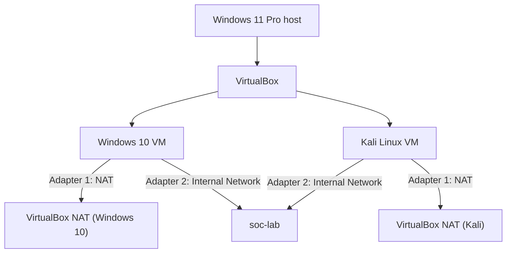

# Virtual Lab — Network Validation Worksheet

**Environment:** Windows 11 Pro host / Oracle VirtualBox / Windows 10 and Kali Linux guests  
**Status (November 15, 2026):** VirtualBox GUI adapter inventory verified for both powered-off VMs. Guest addressing and end-to-end connectivity remain **unverified**.

## Goal and scope

Record every enabled VM adapter and its network attachment before making guest changes. Distinguish **configured virtual network membership** from **proven guest connectivity**. This is a personal educational lab; no external systems are in scope.

A host-only network may have been configured earlier, but neither of the two guests currently has an enabled host-only adapter in the November 15 GUI inventory. The observed layout uses **NAT + Internal Network**.

## 1. VirtualBox adapter inventory — verified November 15

Source: four read-only **Settings → Network** screenshots per VM, viewed while both VMs were **Powered Off**.

| Guest | Adapter | Enabled | Attached to | Network name | Adapter type | Virtual cable | Promiscuous mode |
| --- | --- | --- | --- | --- | --- | --- | --- |
| Windows 10 | 1 | Yes | NAT | N/A | Intel PRO/1000 MT Desktop (82540EM) | Connected | Deny (field inactive for NAT) |
| Windows 10 | 2 | Yes | Internal Network | `soc-lab` | Intel PRO/1000 MT Desktop (82540EM) | Connected | Deny |
| Windows 10 | 3 | No | Not attached | N/A | N/A (disabled) | N/A | N/A |
| Windows 10 | 4 | No | Not attached | N/A | N/A (disabled) | N/A | N/A |
| Kali Linux | 1 | Yes | NAT | N/A | Intel PRO/1000 MT Desktop (82540EM) | Connected | Deny (field inactive for NAT) |
| Kali Linux | 2 | Yes | Internal Network | `soc-lab` | Intel PRO/1000 MT Desktop (82540EM) | Connected | Deny |
| Kali Linux | 3 | No | Not attached | N/A | N/A (disabled) | N/A | N/A |
| Kali Linux | 4 | No | Not attached | N/A | N/A (disabled) | N/A | N/A |

The screenshots display VirtualBox MAC addresses; these identifiers are intentionally **not transcribed** here. Original screenshots were reviewed during the session, but **sanitized screenshots have not yet been uploaded** to GitHub.

### Configured topology, not a connectivity claim



The diagram reflects configured attachment modes only. NAT permits potential outside connectivity under normal operation; actual connectivity was not tested during this inventory. Internal-network membership does not establish successful guest-to-guest communication. The host is not shown as a participant in `soc-lab`.

## 2. Collect current guest addressing — pending

Because Windows 10 previously experienced intermittent responsiveness problems, do not rush to launch multiple VMs or change their network settings just to complete the worksheet. Preserve the existing snapshots and virtual disks.

Once a guest can be safely started, collect its current addressing and routing in a read-only way.

Windows 10 PowerShell:

```powershell
ipconfig /all
route print
```

Kali Linux terminal:

```bash
ip -br addr
ip route
```

Record actual interface-to-adapter mapping and current addressing rather than copying historical IP addresses from earlier sessions. Do not publish usernames, MAC addresses or other unnecessary host identifiers.

| Guest | Internal adapter address | Evidence | Status |
| --- | --- | --- | --- |
| Windows 10 | Not verified in this session | None added | Pending |
| Kali Linux | Not verified in this session | None added | Pending |

## 3. Test only authorized internal-lab endpoints — pending

After both guest addresses and the `soc-lab` interface mapping are verified, perform a narrowly scoped reachability test on the **internal-network interfaces**, not by assuming that a successful NAT connection proves guest-to-guest reachability.

Windows 10:

```powershell
ping <verified-kali-internal-ip>
```

Kali Linux:

```bash
ping -c 4 <verified-windows10-internal-ip>
```

These are **planned commands**, not executed results. Failure could reflect IP configuration, local firewall/ICMP filtering or another guest issue. Only tests actually executed will be marked successful or failed.

| Source guest | Destination guest | Intended interface | Actual result | Evidence |
| --- | --- | --- | --- | --- |
| Windows 10 | Kali Linux | `soc-lab` | Not tested | Pending |
| Kali Linux | Windows 10 | `soc-lab` | Not tested | Pending |

## 4. Evidence and completion checklist

- [x] Windows 10: all four VirtualBox adapters inspected
- [x] Kali Linux: all four VirtualBox adapters inspected
- [x] Configured NAT and internal-network attachments documented
- [x] Earlier host-only-only description reconciled against current GUI configuration
- [ ] Sanitized adapter screenshots uploaded (MAC addresses must be redacted)
- [ ] Current internal guest addresses and interface mappings recorded
- [ ] Guest-to-guest connectivity tested and logged
- [ ] Any security or isolation conclusions based on actual tests, not configuration alone

## Next action

Complete a **single-guest, read-only network/address inventory** when the VM can run safely; check the known Windows 10 instability before attempting simultaneous-guest tests. No VM settings, snapshot chains, host virtualization features or security settings need to be changed for this inventory.
